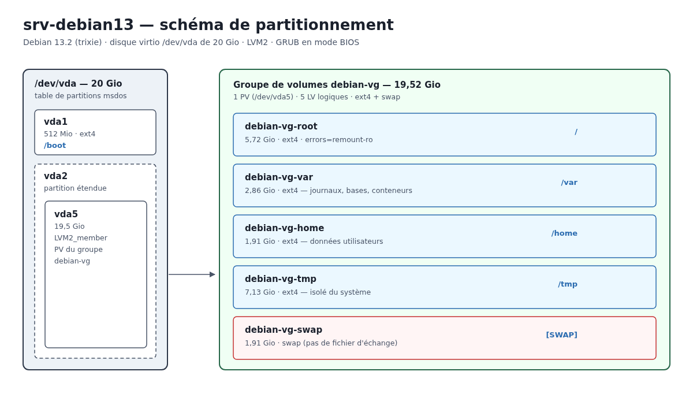
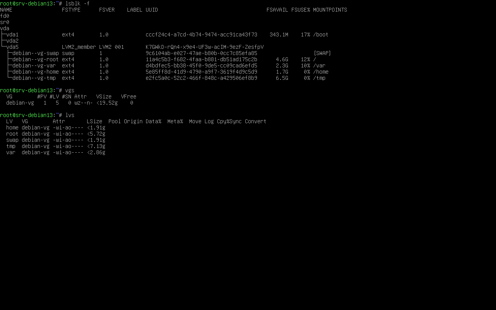
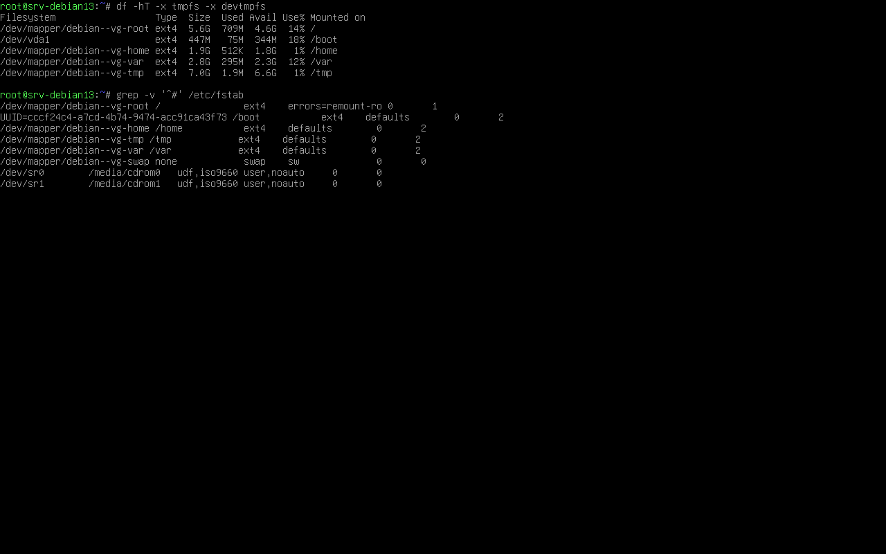
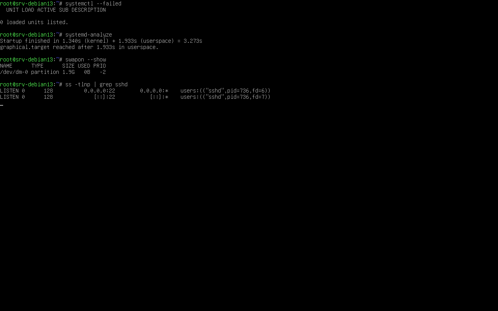
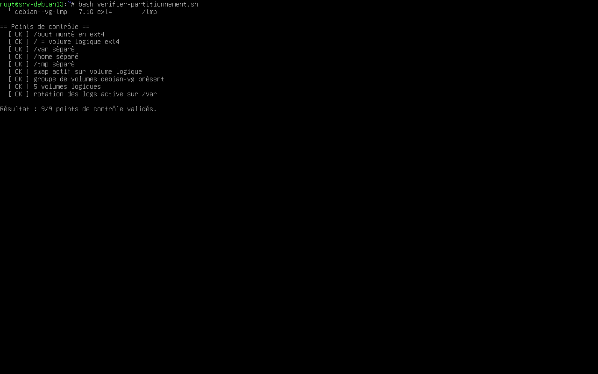

# Installation de Debian 13 avec partitionnement LVM

## Objectif

Installer un serveur Debian 13 minimal avec un partitionnement LVM décidé à l'avance :
`/boot` séparé, puis des volumes logiques distincts pour `/`, `/var`, `/home`, `/tmp` et
le swap. L'objectif est d'avoir une base de serveur où un remplissage de `/var` ou de
`/tmp` ne bloque ni le système ni les utilisateurs, et de vérifier ce schéma après
redémarrage plutôt que de le supposer acquis.

## Environnement

| Élément | Détail |
|---|---|
| Hyperviseur | QEMU/KVM (machine hôte Debian 13, `qemu-system-x86_64` 10.0.13) |
| Système installé | Debian GNU/Linux 13.2 « trixie », noyau 6.12.57+deb13-amd64 |
| Amorçage | BIOS (SeaBIOS 1.16.3), GRUB sur `/dev/vda` |
| Disque | 20 Gio, `virtio` (`/dev/vda`), image qcow2 |
| Mémoire / CPU | 1 Gio / 2 vCPU |
| Réseau | réseau utilisateur QEMU `10.0.2.0/24`, accès SSH par redirection `tcp/2222 → 22` |
| Source | ISO `debian-13.2.0-amd64-netinst.iso`, installation non surveillée (preseed) |

## Architecture

Schéma écrit à partir de la sortie réelle de `lsblk -f`, `vgs` et `lvs` sur la machine
installée. Source : [`schemas/architecture.svg`](schemas/architecture.svg).

## Étapes clés

1. Écriture d'un preseed complet (`configs/preseed-debian13.cfg`) : localisation,
   miroir, horloge sur `Africa/Brazzaville`, et surtout une recette de partitionnement
   LVM manuelle (`partman-auto/expert_recipe`).
2. Démarrage du noyau de l'installateur directement avec les paramètres de preseed,
   pour éviter toute interaction :
   `auto=true priority=critical preseed/url=http://10.0.2.2:8000/preseed-debian13.cfg`.
3. Création du PV sur `/dev/vda5`, du groupe `debian-vg` et des cinq volumes logiques,
   formatage ext4, puis installation de GRUB sur le disque.
4. Dépôt d'une clé SSH publique en fin d'installation (`preseed/late_command`) et
   passage de `PermitRootLogin` à `prohibit-password`.
5. Redémarrage sur le disque installé, puis vérification du schéma obtenu (voir
   ci-dessous) — les tailles réelles ne sont pas toujours celles demandées, c'est
   justement ce qu'il faut contrôler.

## Résultat prouvé

| Capture | Ce qu'elle montre |
|---|---|
|  | Le disque `vda` découpé en `vda1` (`/boot`) + `vda5` (PV LVM), le groupe `debian-vg` et ses 5 volumes logiques avec leurs tailles réelles |
|  | Les systèmes de fichiers montés (`/`, `/var`, `/home`, `/tmp`) et le `fstab` généré, cohérent avec les volumes |
|  | Aucune unité systemd en échec, démarrage en 3,27 s, swap actif, `sshd` à l'écoute |
|  | Le script de contrôle passe ses 9 points : 9/9 validés |

Journaux et transcripts conservés :

- [`logs/03-journal-installation.txt`](logs/03-journal-installation.txt) — extrait de
  `/var/log/installer/syslog` : création du PV, du VG et des LV, puis montage ext4.
- [`logs/01-partitionnement.txt`](logs/01-partitionnement.txt) — `lsblk`, `pvs`, `vgs`,
  `lvs`, `df -hT` et `/etc/fstab` après redémarrage.
- [`logs/04-script-verification.txt`](logs/04-script-verification.txt) — exécution du
  script `scripts/verifier-partitionnement.sh`, code de sortie 0.

Script exécuté sur la machine :
[`scripts/verifier-partitionnement.sh`](scripts/verifier-partitionnement.sh).

## Problèmes rencontrés

| Problème | Cause | Correctif |
|---|---|---|
| L'interface de l'installateur n'apparaissait pas à l'écran, la console restait sur le BIOS | `console=ttyS0` seul dans la ligne de commande du noyau : tout `/dev/console` partait vers le port série | Ajout de `console=tty0` **après** `console=ttyS0` : journal série conservé, interface sur l'écran VGA |
| Les tailles obtenues ne correspondaient pas à la recette (`/` 5,72 Gio au lieu de 6, `/tmp` 7,13 Gio au lieu de 1) | `partman-auto` redistribue l'espace libre du groupe entre les volumes ; une fourchette large laisse la main à l'installateur | Compris et documenté : pour imposer une taille stricte, il faut donner la même valeur en minimum et en maximum dans la recette — vérifié avec `lvs` |
| `vgs`/`lvs` affichaient `File descriptor 4 leaked on vgs invocation` | `openvt` transmet un descripteur ouvert à la commande lancée sur la console virtuelle | `exec 4>&-` en tête du script de capture ; le message a disparu des captures publiées |
| Installation longue (environ 25 minutes) | Les paquets venaient du miroir réseau `deb.debian.org` à travers le NAT QEMU | Acceptable ici ; pour aller plus vite, utiliser le dépôt du CD (`apt-setup/use_mirror boolean false`) |
| Le serveur s'appelait `debian` et non `srv-debian13` | La directive `netcfg/get_hostname` du preseed n'a pas été retenue par l'installeur | Corrigé après coup avec `hostnamectl set-hostname srv-debian13` et l'entrée `127.0.1.1` de `/etc/hosts` ; à vérifier systématiquement en fin d'installation |

## Durée et publication

- Durée : environ 45 minutes, dont 25 minutes d'installation non surveillée.
- Post LinkedIn : à venir.
