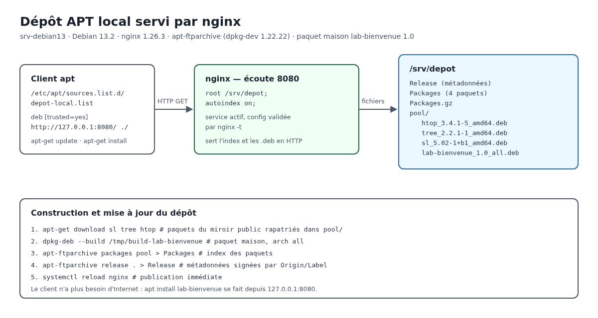
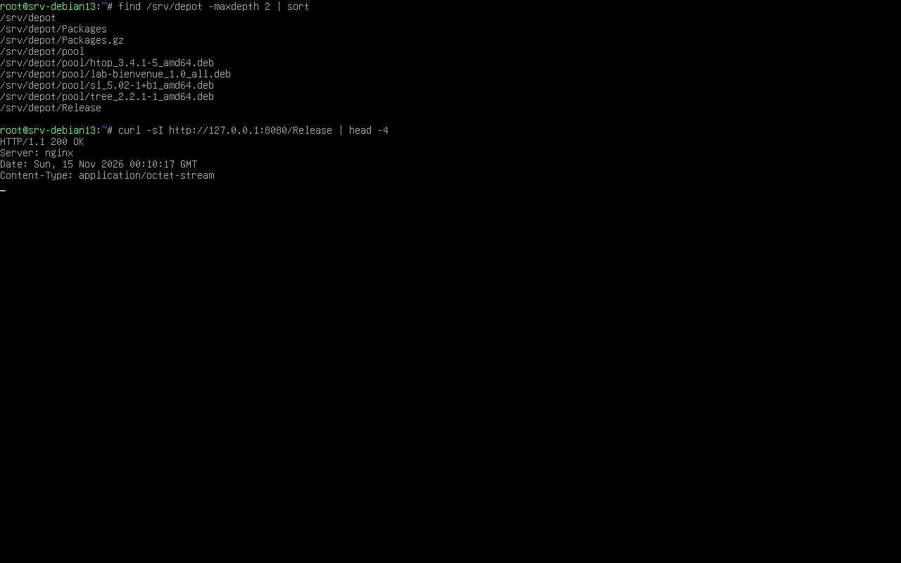
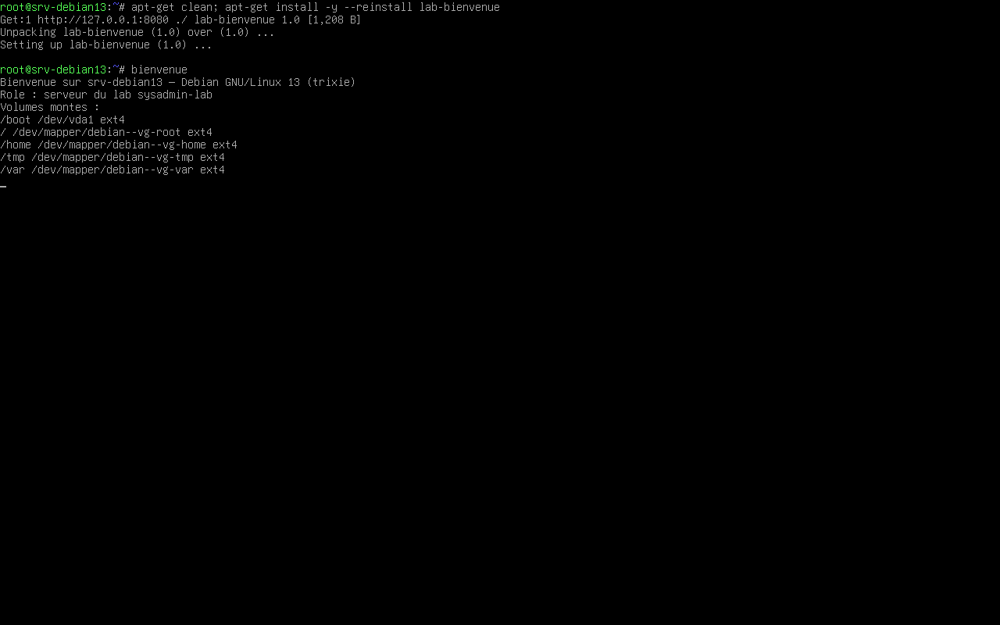
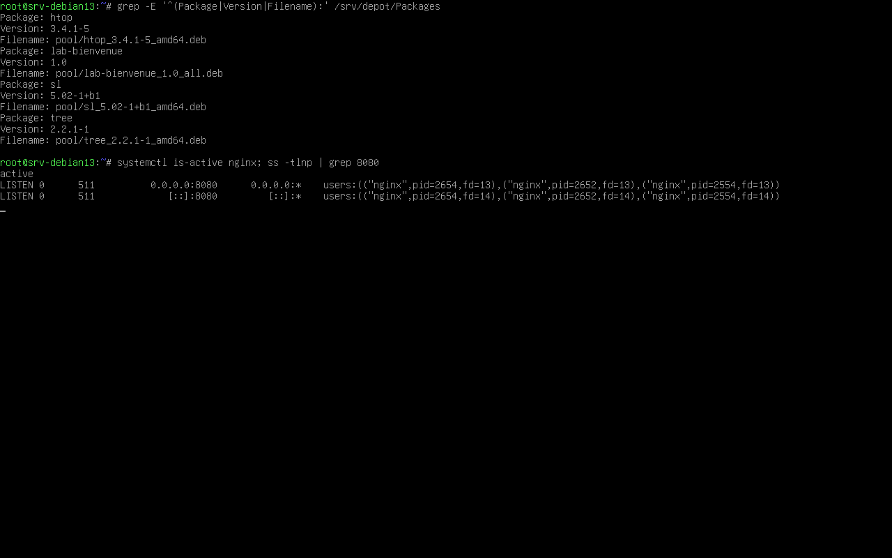

# Dépôt APT local avec apt-ftparchive et nginx

## Objectif

Monter un dépôt Debian interne servi en HTTP, capable de distribuer aussi bien des
paquets récupérés du miroir public qu'un paquet maison construit avec `dpkg-deb`.
Le but n'est pas de copier l'archive Debian entière, mais d'avoir un point de
distribution contrôlé : un serveur sans accès à Internet doit pouvoir installer ce
qu'on y publie, et `apt` doit le voir comme une source normale.

## Environnement

| Élément | Détail |
|---|---|
| Hyperviseur | QEMU/KVM, machine `srv-debian13` |
| Système | Debian GNU/Linux 13.2 « trixie », noyau 6.12.57+deb13-amd64 |
| Disque | LVM : `/` 5,7 Gio, `/var` 2,9 Gio, `/tmp` 7,1 Gio |
| Réseau | `10.0.2.15/24` (NAT QEMU), accès SSH par `tcp/2222` |
| Logiciels | nginx 1.26.3-3+deb13u10, dpkg-dev 1.22.22, apt-utils |
| Dépôt | `/srv/depot`, publié sur `http://127.0.0.1:8080/` |

## Architecture

Source : [`schemas/architecture.svg`](schemas/architecture.svg).

## Étapes clés

1. `apt-get download` de trois paquets du miroir (`sl`, `tree`, `htop`) vers
   `/srv/depot/pool/`, avec un téléchargement lancé depuis un répertoire temporaire
   lisible par l'utilisateur `_apt`.
2. Génération de l'index avec `apt-ftparchive packages pool > Packages` (+ `Packages.gz`).
3. Génération des métadonnées avec `apt-ftparchive release`, en fixant `Origin`,
   `Label`, `Suite` et `Codename` — c'est ce qui distingue le dépôt dans
   `apt-cache policy`.
4. Publication par nginx sur le port 8080 (`root /srv/depot; autoindex on;`), config
   validée par `nginx -t` avant rechargement.
5. Déclaration côté client : `deb [trusted=yes] http://127.0.0.1:8080/ ./`, puis
   `apt-get update`.
6. Fabrication d'un paquet maison `lab-bienvenue` (1,0) avec `dpkg-deb --build`,
   injection dans `pool/`, régénération de l'index, puis installation par `apt` —
   c'est la preuve que la chaîne complète fonctionne.

## Résultat prouvé

| Capture | Ce qu'elle montre |
|---|---|
|  | L'arborescence réelle de `/srv/depot` et la réponse HTTP 200 de nginx sur `Release` |
|  | `apt` télécharge `lab-bienvenue` depuis `http://127.0.0.1:8080`, puis la commande `bienvenue` installée par ce paquet s'exécute |
|  | Le contenu de l'index `Packages` et nginx à l'écoute sur 8080 |

Journaux :

- [`logs/02-construction-depot.txt`](logs/02-construction-depot.txt) — exécution
  complète du script de construction, code de sortie 0.
- [`logs/04-preuve-depot-local.txt`](logs/04-preuve-depot-local.txt) — `apt-cache policy`
  et installation depuis le dépôt.
- [`logs/05-paquet-maison.txt`](logs/05-paquet-maison.txt) — construction du `.deb`.

Scripts exécutés :
[`scripts/construire-depot.sh`](scripts/construire-depot.sh) et
[`scripts/construire-paquet.sh`](scripts/construire-paquet.sh).

## Problèmes rencontrés

| Problème | Cause | Correctif |
|---|---|---|
| `W: Download is performed unsandboxed as root ... couldn't be accessed by user '_apt'` à chaque `apt-get download` | Le téléchargement était lancé dans `/srv/depot`, répertoire root non lisible par `_apt` : apt retombait sur un téléchargement non sandboxé | Télécharger dans un `mktemp -d` puis déplacer les `.deb` vers `pool/` ; les avertissements ont disparu de la sortie du script |
| Un `Pin: origin 127.0.0.1 / Pin-Priority: 1001` ne changeait pas la source de téléchargement de `sl` | Le pin arbitre la **version** retenue, pas l'origine du fichier : `apt` a continué à prendre le `.deb` sur `deb.debian.org`, seule la colonne de priorité changeait dans `apt-cache policy` | Configuration retirée. La bonne preuve d'un dépôt interne est un paquet qui n'existe **que** là : `lab-bienvenue`, téléchargé depuis `127.0.0.1:8080` |
| `apt-get install --reinstall` ne montrait aucun téléchargement | Le `.deb` était déjà dans `/var/cache/apt/archives` | `apt-get clean` avant la démonstration, pour forcer un vrai `GET` HTTP |

## Durée et publication

- Durée : environ 30 minutes (dont ~2 minutes de construction du dépôt).
- Post LinkedIn : à venir.
