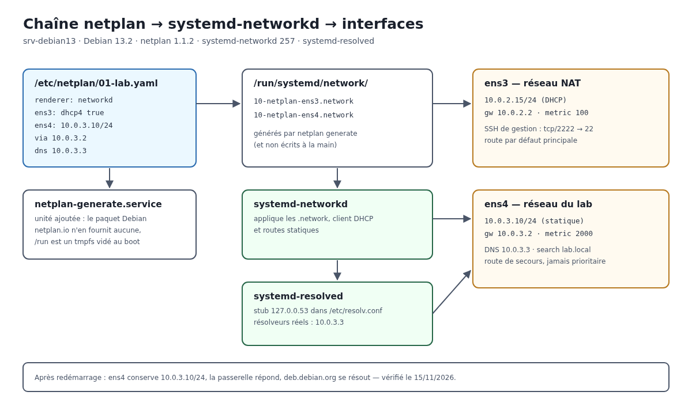
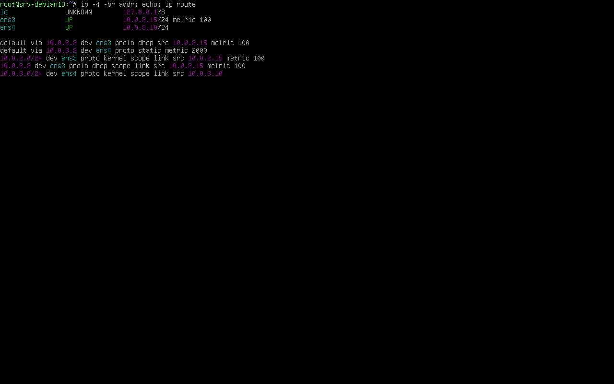
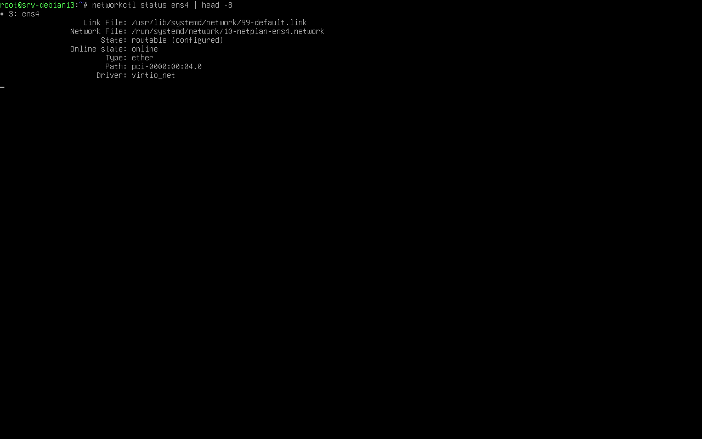
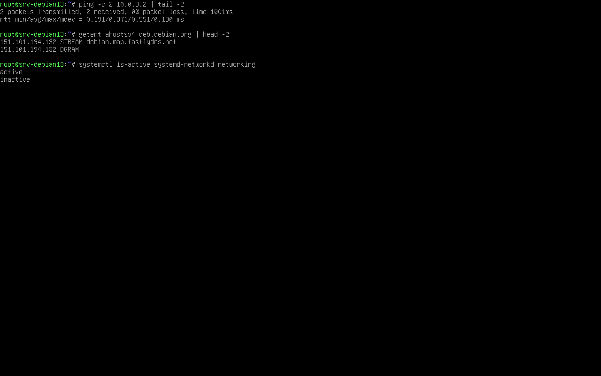

# Configuration réseau avec netplan : IP fixe, passerelle et DNS

## Objectif

Donner à un serveur Debian deux adresses : une en DHCP pour la gestion, une fixe sur
le réseau du lab, avec sa passerelle et son résolveur DNS déclarés explicitement.
Le vrai sujet n'est pas d'écrire un YAML, c'est de vérifier que la configuration
survit au redémarrage — et sur Debian, netplan ne le fait pas tout seul.

## Environnement

| Élément | Détail |
|---|---|
| Hyperviseur | QEMU/KVM, machine `srv-debian13` |
| Système | Debian GNU/Linux 13.2 « trixie », noyau 6.12.57+deb13-amd64 |
| Logiciels | netplan 1.1.2, systemd-networkd 257.13, systemd-resolved, ifupdown 0.8.44 |
| Carte 1 (ens3) | réseau utilisateur QEMU `10.0.2.0/24`, DHCP, SSH par `tcp/2222 → 22` |
| Carte 2 (ens4) | réseau du lab `10.0.3.0/24`, adresse fixe `10.0.3.10/24` |
| Passerelle / DNS du lab | `10.0.3.2` / `10.0.3.3` |

## Architecture

Source : [`schemas/architecture.svg`](schemas/architecture.svg).

## Étapes clés

1. Installation de `netplan.io` puis écriture de
   [`configs/01-lab.yaml`](configs/01-lab.yaml) : `ens3` en DHCP (avec `use-dns: false`),
   `ens4` en adresse fixe, route par défaut à métrique 2000, DNS `10.0.3.3` et domaine
   de recherche `lab.local`.
2. `netplan generate` puis `netplan apply` ; bascule de `systemd-networkd` à la place de
   `ifupdown` (`systemctl disable networking`).
3. Constat que la configuration ne survit pas au redémarrage : le paquet Debian
   `netplan.io` ne livre aucune unité systemd, et `netplan generate` écrit dans
   `/run/systemd/network` — un tmpfs vidé à chaque boot.
4. Ajout de [`configs/netplan-generate.service`](configs/netplan-generate.service), qui
   régénère les fichiers avant le démarrage de `systemd-networkd`.
5. Nettoyage de `/etc/network/interfaces`, qui gardait un `allow-hotplug ens3` : udev
   remontait l'interface dans le dos de netplan.
6. Sans `systemd-resolved`, netplan n'écrit pas `/etc/resolv.conf` : installation de
   resolved et bascule de `resolv.conf` sur le stub `127.0.0.53`.
7. Redémarrage propre, puis vérification de l'adressage, de la passerelle et de la
   résolution.

## Résultat prouvé

| Capture | Ce qu'elle montre |
|---|---|
|  | Après redémarrage : `ens3` en DHCP, `ens4` à `10.0.3.10/24`, et la route par défaut qui reste sur `ens3` (métrique 100 contre 2000) |
|  | L'état de `ens4` vu par `networkctl` : fichier `.network` généré par netplan, état `configured` |
|  | Passerelle `10.0.3.2` joignable, `deb.debian.org` résolu, `systemd-networkd` actif et `ifupdown` arrêté |

Journaux :

- [`logs/03-application.txt`](logs/03-application.txt) — application de la configuration.
- [`logs/04-tests-reseau.txt`](logs/04-tests-reseau.txt) — tests de connectivité.
- [`logs/05-resolved.txt`](logs/05-resolved.txt) et
  [`logs/06-dns-effectif.txt`](logs/06-dns-effectif.txt) — résolveurs réellement utilisés.
- [`logs/07-apres-redemarrage.txt`](logs/07-apres-redemarrage.txt) — état après reboot.
- [`logs/08-integration-demarrage.txt`](logs/08-integration-demarrage.txt) — mise en
  place de l'unité de génération.

Scripts exécutés : [`scripts/appliquer-netplan.sh`](scripts/appliquer-netplan.sh),
[`scripts/activer-resolved.sh`](scripts/activer-resolved.sh),
[`scripts/integrer-netplan-au-demarrage.sh`](scripts/integrer-netplan-au-demarrage.sh).

## Problèmes rencontrés

| Problème | Cause | Correctif |
|---|---|---|
| Après redémarrage, `ens4` n'avait plus d'adresse et `/run/systemd/network/` était vide | Le paquet `netplan.io` de Debian ne fournit aucun générateur ni unité systemd : `netplan generate` écrit dans `/run`, un tmpfs perdu au boot | Unité `netplan-generate.service` exécutée avant `systemd-networkd` |
| `ens3` gardait une adresse malgré `networking` désactivé | `/etc/network/interfaces` contenait `allow-hotplug ens3` : la règle udev lance `ifup` dès que l'interface apparaît | `/etc/network/interfaces` réduit à la boucle locale, sauvegarde conservée |
| Les résolveurs de netplan étaient ignorés, `/etc/resolv.conf` pointait encore sur `10.0.2.3` | Sans `systemd-resolved`, netplan ne gère pas `resolv.conf` | Installation de `systemd-resolved`, `resolv.conf` en lien vers `/run/systemd/resolve/stub-resolv.conf` |
| La route par défaut est passée par `ens4` après redémarrage | La route statique était en métrique 500, mais la route DHCP de `ens3` remonte à 1002 : la statique gagnait | Métrique `ens4` fixée à 2000 |
| `netplan generate` refusait de lire `01-lab.yaml` : `Invalid YAML: aliases are not supported` | Le fichier était rempli d'octets nuls après un arrêt brutal de la VM (données non synchronisées sur ext4) | Fichier restauré, `sync` puis arrêt propre (`systemctl poweroff`) désormais systématique |
| `resolvectl dns` répondait `Connection timed out` alors que la résolution fonctionnait | Échange D-Bus avec `systemd-resolved` en échec sur cette VM | Vérification par `/run/systemd/resolve/resolv.conf` et `networkctl status` |

## Durée et publication

- Durée : environ 1 heure, dont deux redémarrages de contrôle.
- Post LinkedIn : à venir.
