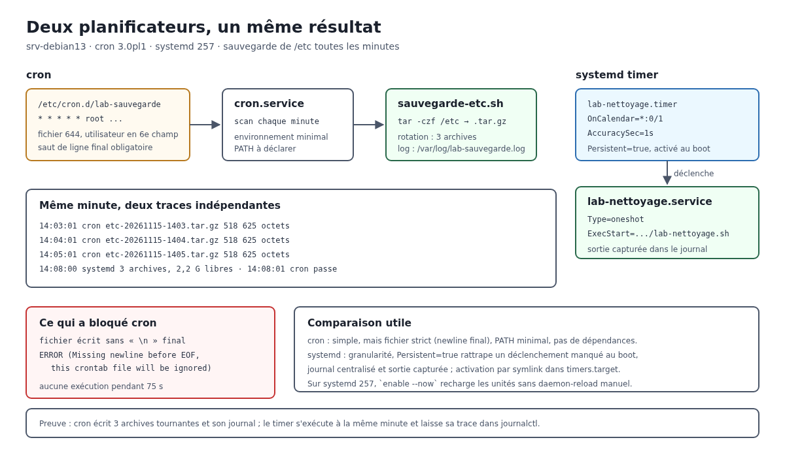
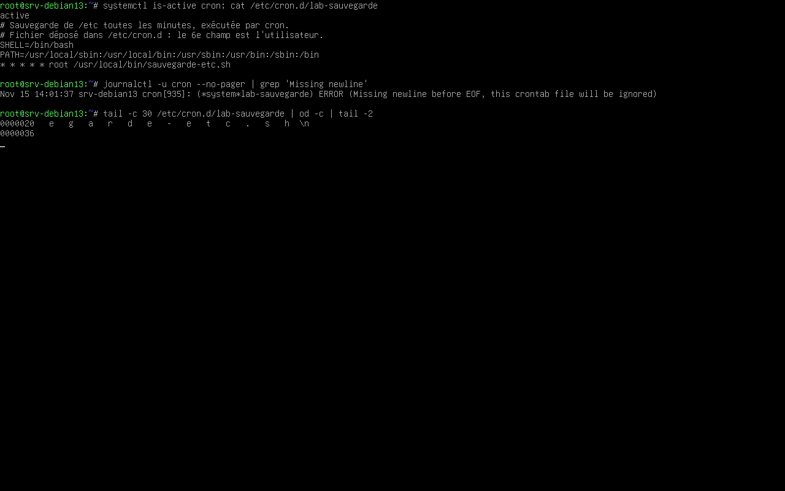
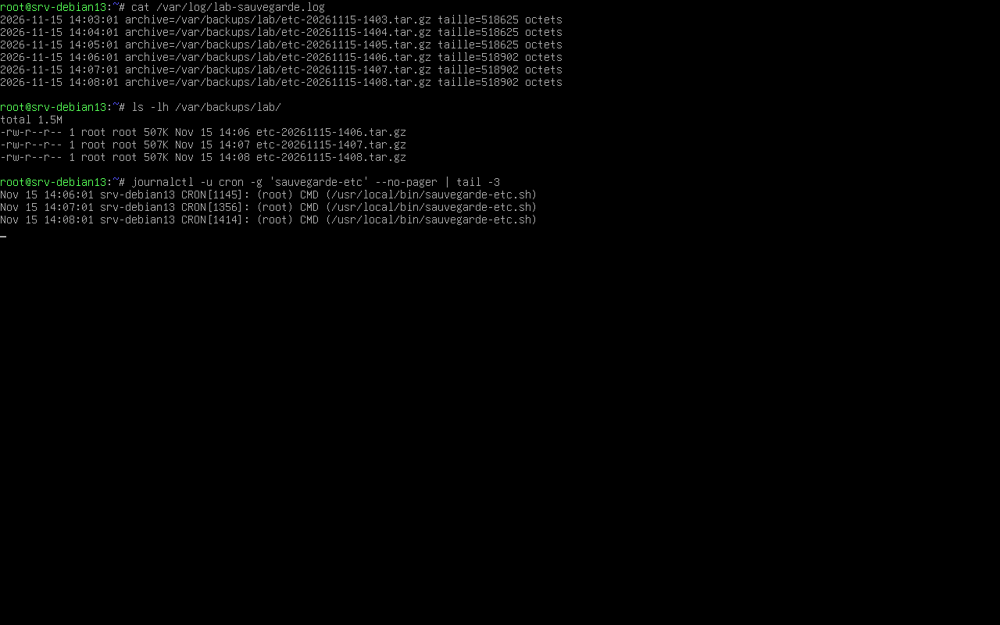
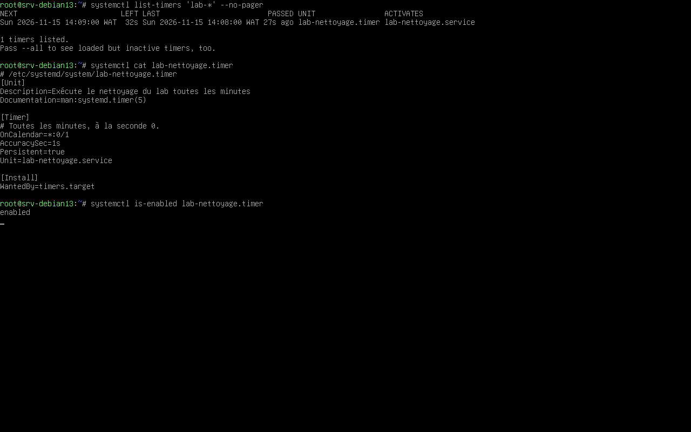
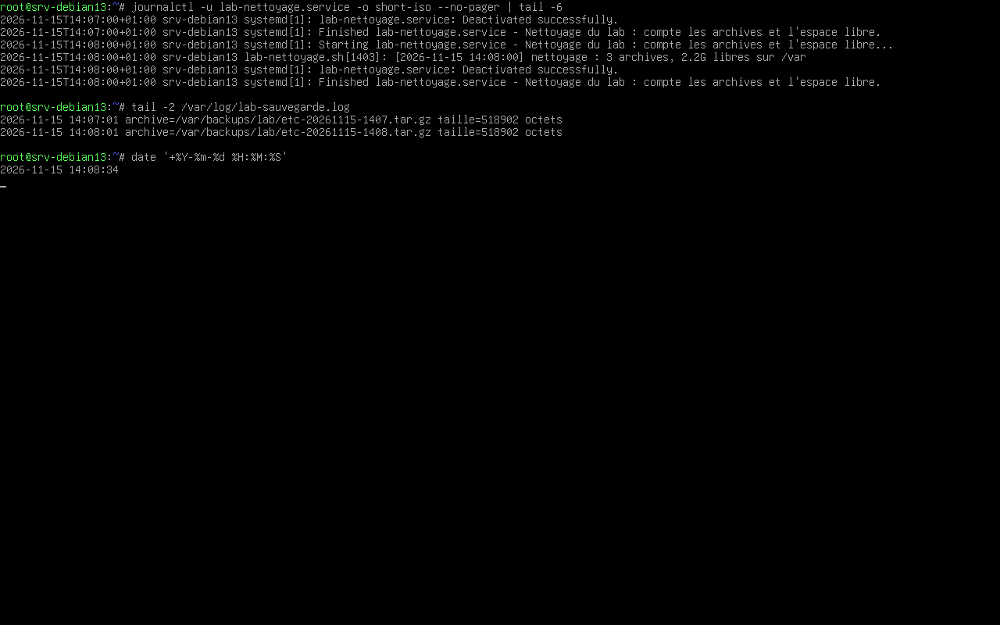

# Planifier des tâches avec cron et les timers systemd

## Objectif

Planifier la même tâche — une sauvegarde de `/etc` — avec les deux mécanismes
disponibles sous Linux : une entrée `cron` déposée dans `/etc/cron.d` et un couple
`timer`/`service` systemd. Le but est de comparer ce qu'ils demandent vraiment,
de prouver que les deux s'exécutent, et de documenter un piège de cron qui ne
produit aucune erreur visible tant qu'on ne lit pas le journal.

## Environnement

| Élément | Détail |
|---|---|
| Hyperviseur | QEMU/KVM, machine `srv-debian13` |
| Système | Debian GNU/Linux 13.2 « trixie » |
| Logiciels | cron 3.0pl1n2, systemd 257 (257.13-1~deb13u1) |
| Tâche cron | `/etc/cron.d/lab-sauvegarde`, toutes les minutes, utilisateur `root` |
| Tâche systemd | `lab-nettoyage.timer`, `OnCalendar=*:0/1`, `Persistent=true` |
| Sorties | `/var/backups/lab/`, `/var/log/lab-sauvegarde.log`, journal systemd |

## Architecture

Source : [`schemas/architecture.svg`](schemas/architecture.svg).

## Étapes clés

1. Script [`scripts/sauvegarde-etc.sh`](scripts/sauvegarde-etc.sh) : archive `/etc`
   en `.tar.gz` horodaté, écrit une ligne dans `/var/log/lab-sauvegarde.log`, puis
   ne conserve que les 3 archives les plus récentes.
2. Première tentative cron : fichier écrit d'un seul bloc, **sans saut de ligne
   final** — exactement ce que produit un `printf '%s'` ou un `echo -n`. Cron
   recharge, attend 75 s, et n'exécute rien.
3. Lecture du journal de `cron.service` : l'erreur est explicite, le fichier est
   ignoré. Ajout du `\n` final, rechargement, deux minutes d'attente : trois
   archives apparaissent, une par minute.
4. Timer systemd : service `Type=oneshot` + timer `OnCalendar=*:0/1` avec
   `AccuracySec=1s` et `Persistent=true`, activés par
   `systemctl enable --now lab-nettoyage.timer`.
5. Vérification finale : `systemctl list-timers 'lab-*'`, `systemctl is-enabled`,
   contenu des deux fichiers de planification, journal de cron et journal du
   service, puis comparaison des horodatages.

Scripts exécutés : [`scripts/01-installer-cron.sh`](scripts/01-installer-cron.sh),
[`scripts/02-corriger-cron.sh`](scripts/02-corriger-cron.sh),
[`scripts/03-installer-timer.sh`](scripts/03-installer-timer.sh),
[`scripts/04-verifier.sh`](scripts/04-verifier.sh).
Configurations publiées : [`configs/cron-lab-sauvegarde`](configs/cron-lab-sauvegarde),
[`configs/lab-nettoyage.service`](configs/lab-nettoyage.service),
[`configs/lab-nettoyage.timer`](configs/lab-nettoyage.timer).

## Résultat prouvé

| Capture | Ce qu'elle montre |
|---|---|
|  | Le fichier cron en place, l'erreur réelle `ERROR (Missing newline before EOF, this crontab file will be ignored)` à 14:01:37, et le `\n` final présent après correction (`od -c`) |
|  | Six exécutions de 14:03:01 à 14:08:01, les 3 archives tournantes restantes (rotation) et les lignes `CMD (/usr/local/bin/sauvegarde-etc.sh)` de cron |
|  | `lab-nettoyage.timer` listé avec sa prochaine échéance, son unité complète (`OnCalendar=*:0/1`, `Persistent=true`) et `enabled` |
|  | Le service exécuté à 14:08:00 avec sa sortie capturée, et cron passé à 14:08:01 : les deux mécanismes tournent à la même minute |

Journaux :

- [`logs/01-etat-initial.txt`](logs/01-etat-initial.txt) — cron actif, aucun
  fichier dans `/etc/cron.d` hormis ceux du système.
- [`logs/02-cron-sans-saut-de-ligne.txt`](logs/02-cron-sans-saut-de-ligne.txt) —
  l'échec : 75 s d'attente, aucune ligne dans le log de sauvegarde.
- [`logs/03-cron-corrige.txt`](logs/03-cron-corrige.txt) — correction et trois
  exécutions consécutives.
- [`logs/04-timer-systemd.txt`](logs/04-timer-systemd.txt) — dépôt des unités,
  activation, deux déclenchements.
- [`logs/05-verification-finale.txt`](logs/05-verification-finale.txt) — état
  final et comparaison des horodatages.

## Problèmes rencontrés

| Problème | Cause | Correctif |
|---|---|---|
| Aucune exécution pendant 75 s, sans message sur la console | Cron exige un saut de ligne final dans un fichier de `/etc/cron.d` ; sans lui il ignore **tout** le fichier, et l'erreur ne part que dans le journal | Ajouter le `\n` final (`printf '\n' >> /etc/cron.d/lab-sauvegarde`) puis recharger cron ; vérifier avec `od -c` |
| `systemctl enable --now lab-nettoyage.timer` a fonctionné sans `daemon-reload` | Comportement de systemd 257 : `enable` recharge les unités à la demande, contrairement à l'ordre classique « déposer, `daemon-reload`, activer » | Constat assumé et vérifié ; le `daemon-reload` explicite reste dans le script et ne casse rien |
| Cron n'hérite pas de l'environnement du shell interactif | Le démon démarre avec un environnement minimal, sans le `PATH` habituel | `SHELL` et `PATH` déclarés en tête du fichier cron, et chemins absolus dans le script |

## Durée et publication

- Durée : environ 45 minutes (dont 4 minutes d'attente réelle pour observer les
  déclenchements).
- Post LinkedIn : à venir.
- Auteur : [Jenovi Dandou](https://www.linkedin.com/in/jenovi-dandou).
