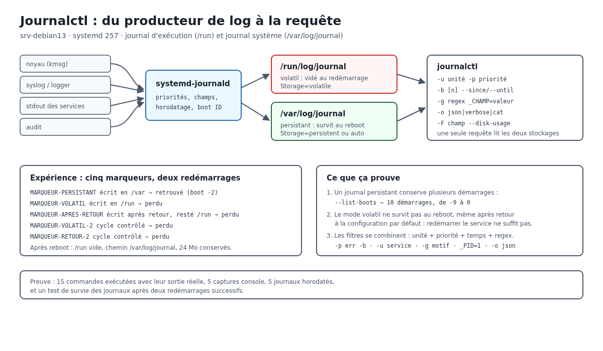
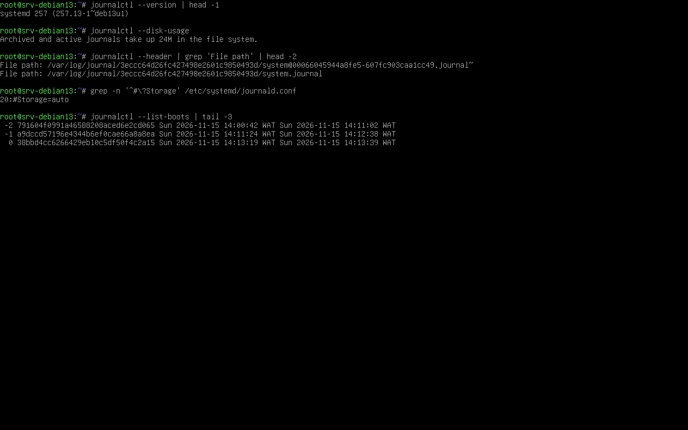
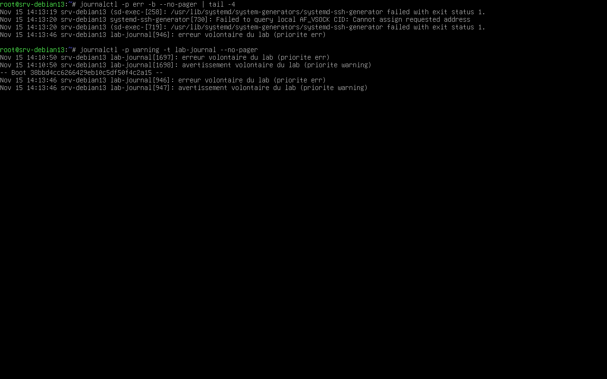
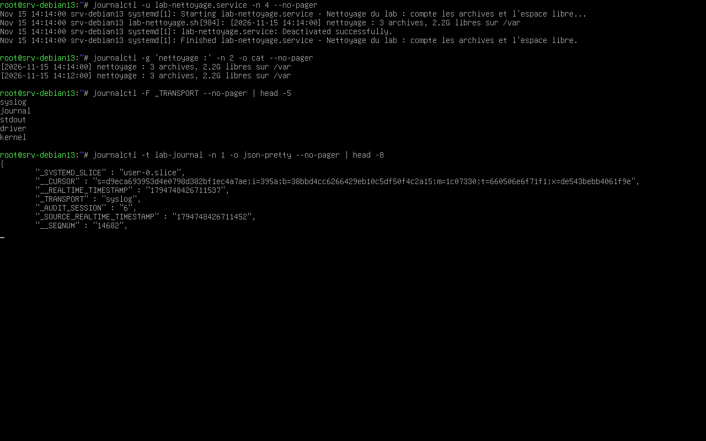
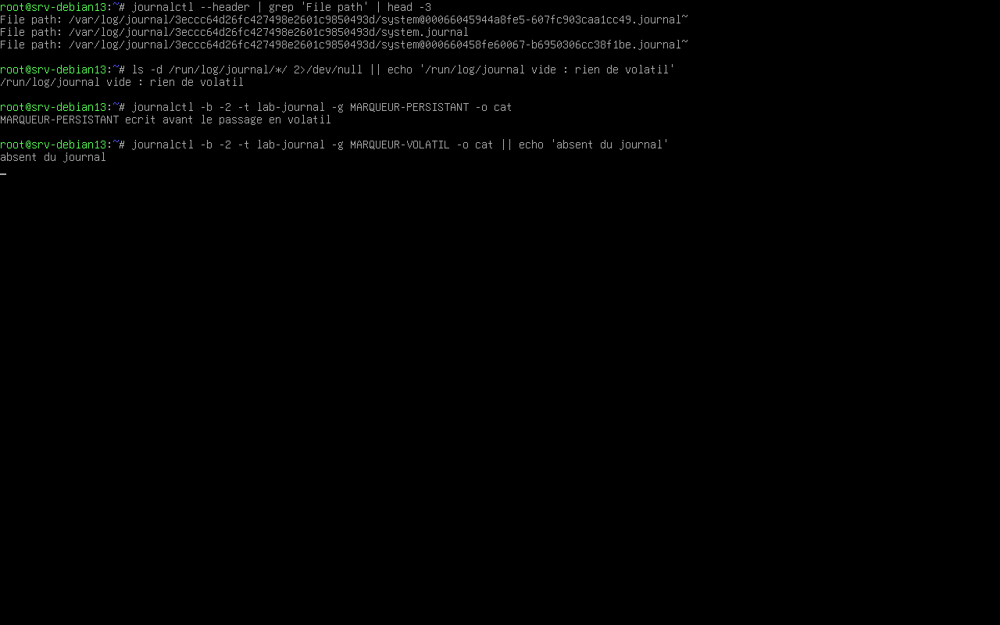
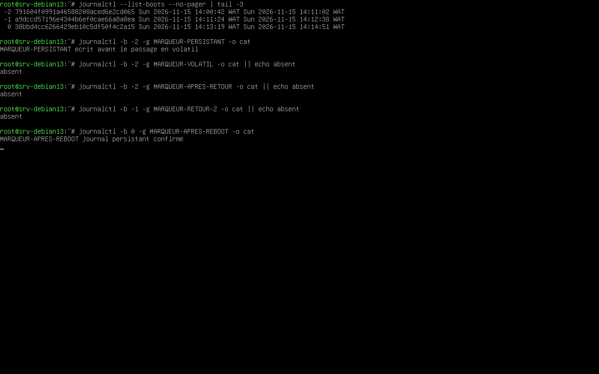

# Maîtriser journalctl : filtres, priorités, persistance des logs

## Objectif

Savoir interroger le journal systemd pour de vrai : filtrer par unité, priorité,
période, champ ou expression, sortir en JSON ou en format verbeux, et comprendre où
les messages sont stockés. Le projet teste aussi la différence entre journal volatil
(`/run`) et journal persistant (`/var/log/journal`) avec des marqueurs écrits à chaque
étape, puis deux redémarrages : ce qui survit et ce qui disparaît est constaté, pas
supposé.

## Environnement

| Élément | Détail |
|---|---|
| Hyperviseur | QEMU/KVM, machine `srv-debian13` |
| Système | Debian GNU/Linux 13.2 « trixie » |
| Journal | systemd 257 (257.13-1~deb13u1), `Storage=auto` commenté par défaut |
| Journal initial | 10 démarrages conservés, 24 Mo |
| Mode testé | drop-in `Storage=volatile`, puis retour à la configuration par défaut |
| Livrable | [`aide-memoire.md`](aide-memoire.md) : 15 commandes testées |

## Architecture

Source : [`schemas/architecture.svg`](schemas/architecture.svg).

## Étapes clés

1. État des lieux : version, `--disk-usage` (24 Mo), `--header` (chemin réel du
   fichier), configuration `Storage`, `--list-boots` (10 démarrages).
2. Messages de test écrits avec `logger` à trois priorités (`local0.err`,
   `local0.warning`, `local0.info`) et un tag commun `lab-journal`.
3. Quinze commandes exécutées avec leur sortie : `-n`, `-b`, `-b -1`, `--list-boots`,
   `-u`, `-p`, `--since/--until`, `-g`, `_PID=`, `-F`, `-o json-pretty`,
   `-o verbose`, `-k`, `--disk-usage`, `--verify`. Voir
   [`aide-memoire.md`](aide-memoire.md).
4. Expérience de persistance : un marqueur écrit en mode persistant, bascule en
   `Storage=volatile` (drop-in [`configs/90-lab-volatile.conf`](configs/90-lab-volatile.conf)),
   marqueur volatil, retour à la configuration par défaut, marqueur de retour.
   Le chemin réel du journal est relevé à chaque étape avec `--header`.
5. Redémarrage complet, puis second cycle contrôlé (volatil → retour) avec suivi du
   PID de journald, et second redémarrage. Chaque marqueur est ensuite recherché
   dans le démarrage où il a été écrit.

Scripts exécutés : [`scripts/01-filtres.sh`](scripts/01-filtres.sh),
[`scripts/02-volatile-vs-persistant.sh`](scripts/02-volatile-vs-persistant.sh),
[`scripts/03-apres-redemarrage.sh`](scripts/03-apres-redemarrage.sh),
[`scripts/04-cycle-controle.sh`](scripts/04-cycle-controle.sh).

## Résultat prouvé

| Capture | Ce qu'elle montre |
|---|---|
|  | systemd 257, 24 Mo de journaux, deux chemins `/var/log/journal`, `#Storage=auto` et les trois derniers démarrages conservés |
|  | `-p err -b` remonte les erreurs réelles du boot (générateur SSH), et `-p warning -t lab-journal` ne garde que les messages du lab à priorité ≥ warning |
|  | `-u lab-nettoyage.service` avec la sortie du service, `-g` sur le texte, les valeurs de `_TRANSPORT` et un enregistrement complet en JSON |
|  | Le journal courant est dans `/var/log/journal`, `/run` est vide, le marqueur persistant est retrouvé et le marqueur volatil est absent |
|  | Les trois démarrages, `MARQUEUR-PERSISTANT` présent, `MARQUEUR-VOLATIL`, `MARQUEUR-APRES-RETOUR` et `MARQUEUR-RETOUR-2` absents, et le nouveau marqueur écrit après reboot bien présent |

Journaux :

- [`logs/01-etat-initial.txt`](logs/01-etat-initial.txt) — état initial complet.
- [`logs/02-filtres.txt`](logs/02-filtres.txt) — les quinze commandes et leurs
  sorties réelles.
- [`logs/03-volatile-vs-persistant.txt`](logs/03-volatile-vs-persistant.txt) —
  premier passage en volatil et retour, avec les chemins de fichiers.
- [`logs/04-apres-redemarrage-echec.txt`](logs/04-apres-redemarrage-echec.txt) —
  première vérification, interrompue par le code de sortie 1 de `journalctl`.
- [`logs/05-cycle-controle.txt`](logs/05-cycle-controle.txt) — second cycle avec
  suivi du PID de journald.
- [`logs/06-apres-redemarrage.txt`](logs/06-apres-redemarrage.txt) — vérification
  finale des cinq marqueurs.

## Problèmes rencontrés

| Problème | Cause | Correctif |
|---|---|---|
| Impossible de « activer » la persistance : elle l'était déjà | L'image Debian du lab possède `/var/log/journal` et `Storage=auto`, ce qui rend le journal persistant sans configuration supplémentaire | Le projet vérifie la persistance au lieu de l'activer, et la démontre par des marqueurs qui survivent aux redémarrages |
| Après suppression du drop-in et `systemctl restart systemd-journald`, le journal est resté dans `/run` | Le service redémarré a continué d'écrire dans le journal d'exécution du démarrage en cours ; le retour à `/var` n'a eu lieu qu'au redémarrage de la machine | Redémarrer la machine, puis contrôler avec `journalctl --header` que le chemin est bien `/var/log/journal` ; les marqueurs écrits entre-temps sont perdus, ce qui est la preuve du problème |
| Le script de vérification s'est arrêté avec le code 1 | `journalctl` renvoie 1 quand aucun enregistrement ne correspond, et le script tournait en `set -euo pipefail` | Tester le code dans un `if` (`journalctl … | grep -q`) ou ajouter `|| echo absent` |

## Durée et publication

- Durée : environ 50 minutes (dont deux redémarrages de la VM).
- Post LinkedIn : à venir.
- Auteur : [Jenovi Dandou](https://www.linkedin.com/in/jenovi-dandou).
