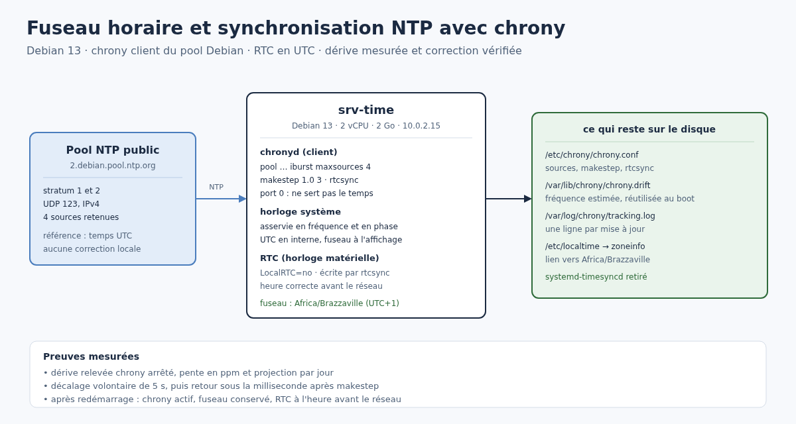
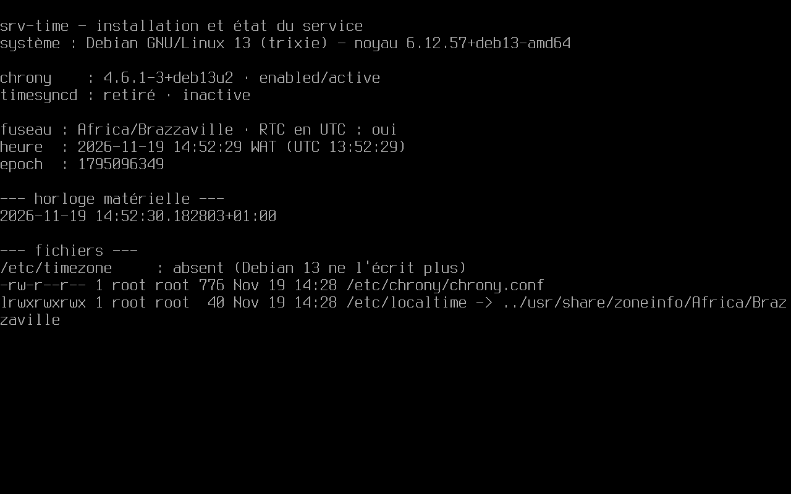
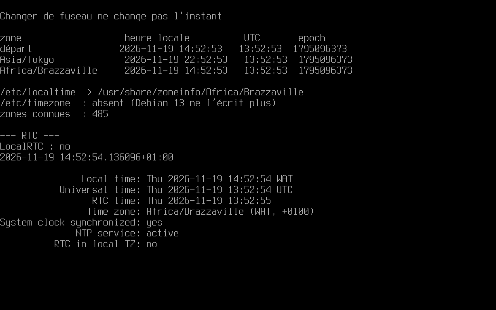
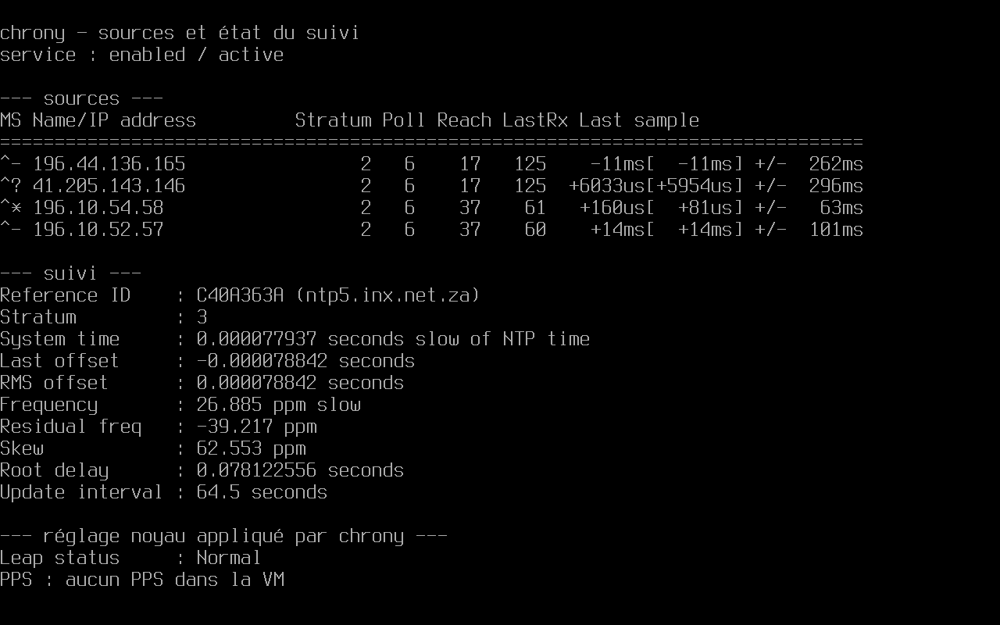
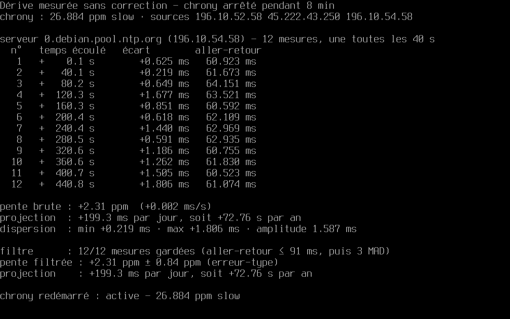
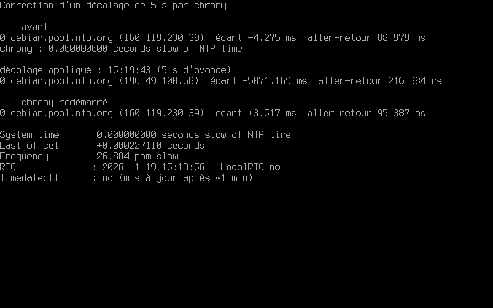
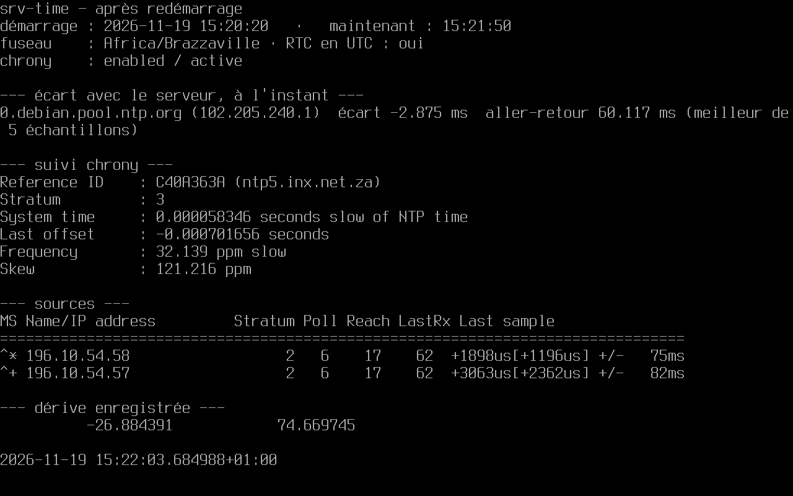

# Configurer le fuseau horaire et la synchronisation NTP avec chrony

## Objectif

Donner à un serveur l'heure juste et un fuseau correct, puis **mesurer** ce qui se
passe quand la synchronisation s'arrête : de combien l'horloge dérive, comment
chrony la remet en place, et comment distinguer une vraie dérive du bruit du réseau.

Trois choses doivent être vraies à la fin :

1. le fuseau est `Africa/Brazzaville` et la RTC (horloge matérielle) reste en UTC ;
2. `chrony` interroge le pool Debian et maintient l'écart sous la milliseconde ;
3. un décalage volontaire de 5 secondes est corrigé, et la dérive propre de la VM
   est chiffrée en ppm avec son incertitude.

## Environnement

| Élément | Détail |
|---|---|
| Hyperviseur | QEMU/KVM, machine `srv-time` (VM jetable, 2 vCPU, 2 Go) |
| Système | Debian GNU/Linux 13.2 « trixie », noyau 6.12.57+deb13-amd64 |
| Logiciels | chrony **4.6.1-3+deb13u2**, tzdata **2026f-0+deb13u1** |
| Réseau | NAT QEMU `10.0.2.15/24` sur `ens3`, accès SSH par redirection `2222` |
| Fuseau | `Africa/Brazzaville` (WAT, UTC+1), RTC en UTC |
| Sources NTP | `2.debian.pool.ntp.org`, `iburst maxsources 4` |
| Mesure | client SNTP écrit pour le projet, [`scripts/sntp-ecart.py`](scripts/sntp-ecart.py) |

## Architecture

Source : [`schemas/architecture.svg`](schemas/architecture.svg).

## Étapes clés

1. **État initial** ([`logs/01-etat-initial.txt`](logs/01-etat-initial.txt)) :
   fuseau déjà en WAT, RTC en UTC, `systemd-timesyncd` actif mais
   `System clock synchronized: no` — le service tourne, il n'a simplement encore
   rien synchronisé.
2. **Nom d'hôte** ([`scripts/01b-nom-hote.sh`](scripts/01b-nom-hote.sh)) : la VM
   s'appelle `debian`, le preseed demandait `srv-time` (voir les incidents).
3. **Fuseau horaire** ([`scripts/02-fuseau-horaire.sh`](scripts/02-fuseau-horaire.sh)) :
   passage par `Asia/Tokyo` puis retour, avec l'epoch relevé à chaque fois pour
   montrer qu'un changement de fuseau ne change pas l'instant, seulement son
   affichage ; puis `timedatectl set-local-rtc 0`.
4. **chrony** ([`configs/chrony.conf`](configs/chrony.conf),
   [`scripts/03-chrony.sh`](scripts/03-chrony.sh)) : pool avec `iburst`,
   `makestep 1.0 3` (corriger d'un coup au-delà d'une seconde, sur les trois
   premières mises à jour), `rtcsync`, journal `tracking`, et `port 0` pour ne pas
   servir le temps au réseau.
5. **Dérive mesurée** : deux séries, chrony arrêté, pour ne pas mesurer la
   correction mais bien l'horloge libre — une courte
   ([`scripts/04-mesure-derive.sh`](scripts/04-mesure-derive.sh)) et une longue
   avec filtre ([`scripts/05-derive-longue.sh`](scripts/05-derive-longue.sh)).
6. **Correction d'un décalage** ([`scripts/06-correction-offset.sh`](scripts/06-correction-offset.sh)) :
   5 secondes ajoutées à la main, chrony redémarré, écart relevé avant, juste après
   et une fois stabilisé.
7. **Persistance** ([`scripts/07-persistance.sh`](scripts/07-persistance.sh)) : après
   redémarrage, le fuseau, la RTC, le service et la dérive mémorisée.

## Résultat prouvé

| Capture | Ce qu'elle montre |
|---|---|
|  | chrony `4.6.1-3+deb13u2` **enabled/active**, `systemd-timesyncd` retiré par l'installation, fuseau `Africa/Brazzaville`, RTC en UTC, `epoch 1795096349`, RTC lue par `hwclock`, `/etc/timezone` absent sur Debian 13 et `/etc/localtime` pointant vers la zone |
|  | Trois lignes, même epoch `1795096373` : `Asia/Tokyo` affiche 22:52:53, `Africa/Brazzaville` 14:52:53, l'UTC 13:52:53 — le fuseau change l'affichage, pas l'instant ; `LocalRTC=no`, 485 zones connues |
|  | Quatre sources, dont deux en erreur (`^?` et `^x`), référence `ntp5.inx.net.za` stratum 3, écart système **0,000078 s**, fréquence 26,885 ppm, `Skew` 62,553 ppm, `Leap status: Normal`, aucun PPS dans la VM |
|  | Douze relevés sur 8 min, chrony arrêté : pente brute **+2,31 ppm**, dispersion 1,587 ms, filtre qui garde 12/12 mesures et donne **+0,84 ppm ± 2,21 ppm** |
|  | Avant : écart 0,000 s. Après `date -s "+5 seconds"` : écart **−5071 ms**. chrony redémarré : écart **+3,5 ms**, RTC à l'heure, et `timedatectl` encore à `no` juste après le saut |
|  | Après redémarrage : chrony actif, fuseau conservé, écart **−2,875 ms** (meilleur de cinq échantillons), sources stratum 2, dérive mémorisée `−26,884391`, RTC lue à 15:22:03 |

Journaux :

- [`logs/01-etat-initial.txt`](logs/01-etat-initial.txt) — état avant travaux et
  installation de chrony (qui retire `systemd-timesyncd`).
- [`logs/01b-nom-hote.txt`](logs/01b-nom-hote.txt) — correction du nom d'hôte.
- [`logs/02-fuseau-horaire.txt`](logs/02-fuseau-horaire.txt) — changements de fuseau
  et contrôle de la RTC.
- [`logs/03-chrony.txt`](logs/03-chrony.txt) — configuration, démarrage,
  `waitsync`, sources, suivi, statistiques, activité.
- [`logs/04-derive.txt`](logs/04-derive.txt) — la série courte de deux minutes, celle
  qui ne prouve rien (voir les incidents).
- [`logs/05-derive-longue.txt`](logs/05-derive-longue.txt) — seize relevés sur huit
  minutes, pente brute **−63,10 ppm**, pente filtrée **+0,11 ppm ± 1,18 ppm**.
- [`logs/06-correction.txt`](logs/06-correction.txt) — décalage de 5 s et retour sous
  les 5 ms.
- [`logs/07-persistance.txt`](logs/07-persistance.txt) — après redémarrage.

Les deux séries longues sont indépendantes : 16 × 30 s dans le journal
(+0,11 ± 1,18 ppm), 12 × 40 s sur la capture (+0,84 ± 2,21 ppm). Elles encadrent
la même conclusion : cette VM dérive de moins de 3 ppm, soit moins de 0,3 s par jour.

## Problèmes rencontrés

| Problème | Cause | Correctif |
|---|---|---|
| La VM s'appelait `debian`, le preseed demandait `srv-time` | Le fichier de preseed est lu par `preseed/url` **après** `netcfg` : la question du nom d'hôte est déjà répondue quand `netcfg/get_hostname` arrive | [`scripts/01b-nom-hote.sh`](scripts/01b-nom-hote.sh) (`hostnamectl` + `/etc/hosts`) ; à la source, il faudrait passer `netcfg/get_hostname=` au noyau |
| La première mesure de dérive donnait **+376 ppm** | Série de deux minutes, où deux échantillons à 170 et 208 ms d'aller-retour sortent à −69 ms : la pente suit le réseau, pas l'horloge | Série de huit minutes et filtre sur l'aller-retour puis sur l'écart à la droite → **+0,11 ppm ± 1,18 ppm** ; pente brute de la même série : −63,10 ppm, soit 5 000 fois la valeur filtrée |
| `chronyc tracking` annonçait « 26,9 ppm slow » alors que la mesure donne ~0 ppm | La fréquence affichée est une estimation en cours de convergence, avec `Skew` de 46 à 121 ppm : l'incertitude est **quatre fois plus grande que la valeur** | Ne lire la fréquence que lorsque `Skew` est descendu ; c'est la colonne à regarder, pas `Frequency` seul |
| `timedatectl` affichait `System clock synchronized: no` alors que chrony était synchronisé | Après un `makestep`, l'indicateur de systemd reste à `no` environ une minute : il est mis à jour périodiquement, pas à l'instant du saut | Vérifier avec `chronyc tracking` (ou `timedatectl show -p NTPSynchronized`) une minute plus tard ; mesuré : `no` à 14:49:04, `yes` à 14:49:49 |
| Un relevé unique annonçait `−257 ms` puis `−72 ms` d'écart | Chaque requête SNTP traverse le réseau public : l'aller-retour variait de 60 à 292 ms, et l'asymétrie se retrouve dans l'écart | `--meilleur N` garde l'échantillon au plus court aller-retour ; les captures l'affichent explicitement (`meilleur de 5 échantillons`) |
| `cat /etc/timezone` renvoyait « No such file » | Debian 13 (tzdata 2026f) ne maintient plus ce fichier : le fuseau est porté par le lien `/etc/localtime` | Ne plus lire `/etc/timezone` ; `timedatectl show -p Timezone` et `readlink /etc/localtime` donnent la même information |
| L'installation de chrony a **désinstallé** `systemd-timesyncd` | Les deux implémentent le client NTP et se déclarent en conflit dans Debian | Aucun : c'est voulu. Le journal le montre (`The following packages will be REMOVED: systemd-timesyncd`), et `timedatectl` continue d'afficher `NTP service: active` |

## Durée et publication

- Durée : environ 1 h 15, dont 8 min d'installation de la VM et trois séries de
  huit minutes pour la dérive.
- Post LinkedIn : à venir.
