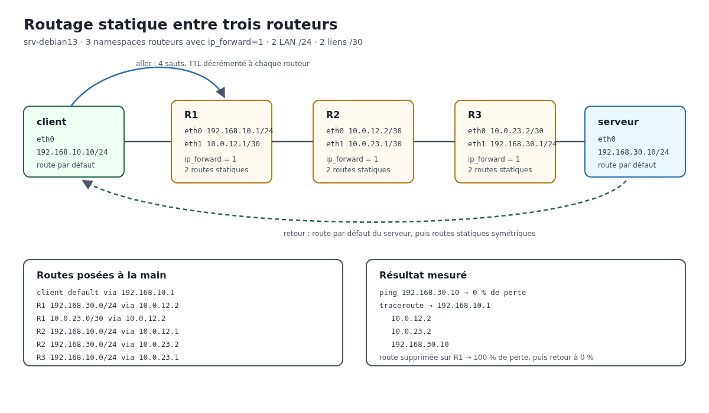
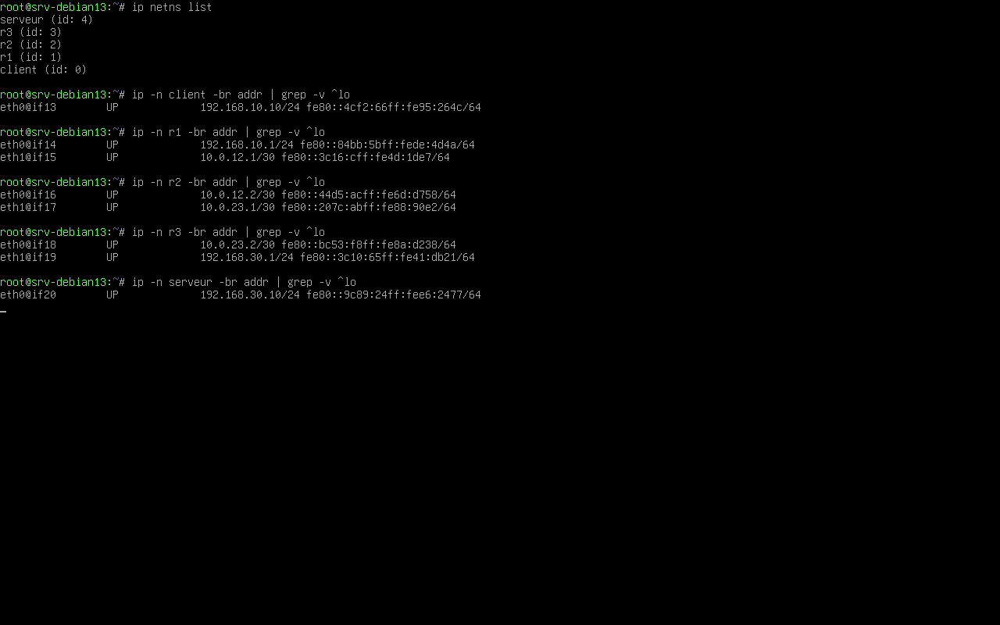
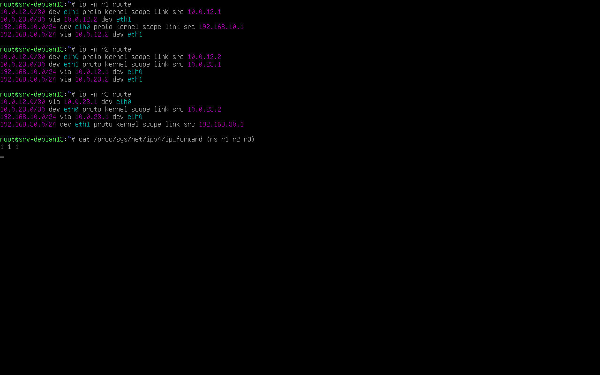
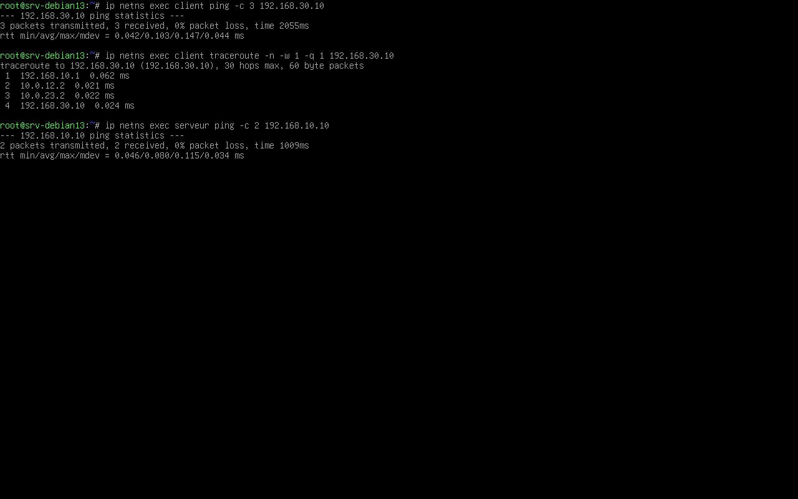
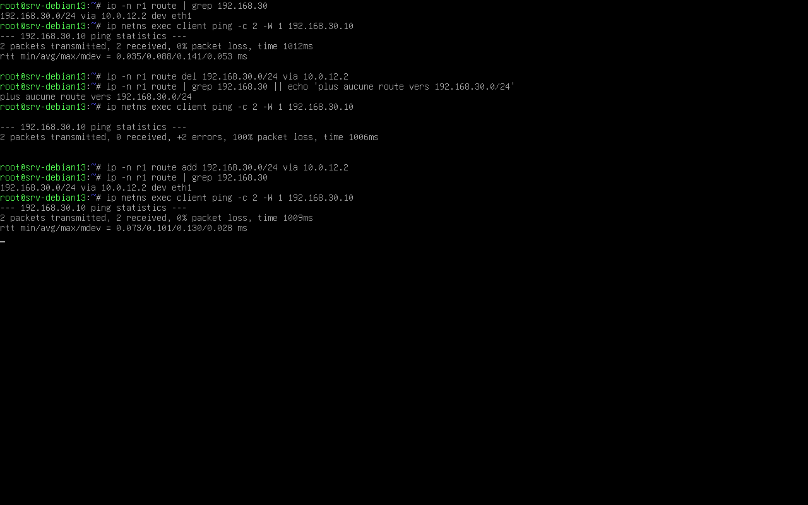

# Configurer le routage statique entre trois routeurs

## Objectif

Relier deux réseaux LAN séparés par trois routeurs, uniquement avec des routes
statiques, et prouver que le chemin est bien celui configuré, saut par saut. La
topologie est construite avec de vrais namespaces réseau Linux : le noyau fait le
routage, les tables affichées sont de vraies tables de routage, pas une simulation.
Le projet montre aussi comment une seule route manquante coupe la connectivité, et
comment la remettre en place.

## Environnement

| Élément | Détail |
|---|---|
| Hyperviseur | QEMU/KVM, machine `srv-debian13` |
| Système | Debian GNU/Linux 13.2 « trixie », iproute2 6.15.0 |
| Routeurs | 3 namespaces Linux (`r1`, `r2`, `r3`) avec `net.ipv4.ip_forward=1` |
| Hôtes | `client` (192.168.10.10/24) et `serveur` (192.168.30.10/24) |
| Liens | `10.0.12.0/30` entre R1 et R2, `10.0.23.0/30` entre R2 et R3 |
| Outils | `ip` (netns, route), `ping`, `traceroute` |

**Choix du lab.** Packet Tracer est installé sur le poste, mais c'est une application
graphique sans mode batch ni API de script : impossible d'y produire des preuves
reproductibles. La topologie est donc montée avec le routage réel du noyau Linux
(namespaces + veth), ce qui donne de vraies tables de routage, de vrais TTL et de
vrais échecs quand une route manque.

## Architecture



Source : [`schemas/architecture.svg`](schemas/architecture.svg).

```
client ── 192.168.10.0/24 ── R1 ── 10.0.12.0/30 ── R2 ── 10.0.23.0/30 ── R3 ── 192.168.30.0/24 ── serveur
```

## Étapes clés

1. Création des cinq namespaces et des quatre liens veth point à point, avec des
   noms temporaires uniques puis renommage dans chaque namespace.
2. Adressage des interfaces : deux LAN en `/24`, deux liens inter-routeurs en `/30`,
   boucle locale activée partout.
3. Activation du routage IPv4 sur R1, R2 et R3 (`ip_forward=1`), vérifiée dans
   `/proc/sys/net/ipv4/ip_forward`.
4. Routes statiques : route par défaut sur les deux hôtes, routes vers les LAN
   distants sur les trois routeurs, plus les routes vers les `/30` distants pour que
   les réponses ICMP puissent revenir.
5. Vérification : `ip route get`, `ping` dans les deux sens, `traceroute` saut par
   saut, puis table de R2.
6. Test de panne : suppression de la route `192.168.30.0/24` sur R1, perte totale
   constatée, remise en place, retour à 0 % de perte.

Scripts exécutés :
[`scripts/construire-topologie.sh`](scripts/construire-topologie.sh),
[`scripts/tester-routage.sh`](scripts/tester-routage.sh),
[`scripts/tester-panne.sh`](scripts/tester-panne.sh).

## Résultat prouvé

| Capture | Ce qu'elle montre |
|---|---|
|  | Les cinq namespaces, et pour chacun l'interface et l'adresse réellement posées : `192.168.10.10/24`, `10.0.12.1/30`, `10.0.23.2/30`, `192.168.30.10/24` |
|  | Les tables de routage complètes de R1, R2 et R3, ainsi que `ip_forward` à `1` sur les trois routeurs |
|  | `ping` client → serveur : 3/3 reçus, 0 % de perte, TTL 61 ; `traceroute` affiche les quatre sauts attendus ; le retour serveur → client passe aussi |
|  | Route présente et ping OK, route supprimée sur R1 et ping à 100 % de perte, route remise et ping de nouveau à 0 % |

Journaux :

- [`logs/01-etat-initial.txt`](logs/01-etat-initial.txt) — état de départ :
  `ip_forward=0`, aucun namespace.
- [`logs/02-construction.txt`](logs/02-construction.txt) — construction complète,
  adressage et routes, code 0.
- [`logs/03-tests-routage.txt`](logs/03-tests-routage.txt) — ping, traceroute et
  chemin retour.
- [`logs/04-panne.txt`](logs/04-panne.txt) — panne provoquée puis réparée.

Tables réelles exportées après construction, publiées telles quelles :
[`configs/tables-routage.txt`](configs/tables-routage.txt).

## Problèmes rencontrés

| Problème | Cause | Correctif |
|---|---|---|
| `RTNETLINK answers: File exists` à la création des liens, code de sortie 2 | Les deux extrémités d'un veth ne peuvent pas porter le même nom dans le même namespace : `ip link add eth0 type veth peer name eth0` échoue sur la seconde extrémité | Créer des noms temporaires uniques (`tmp1a`/`tmp1b`), déplacer chaque extrémité dans son namespace, puis renommer en `eth0`/`eth1` à l'intérieur |
| `traceroute` affichait un `*` au saut 3 et R3 ne pouvait pas joindre le client | R3 ne connaissait pas le réseau `10.0.12.0/30` : ses réponses ICMP vers le client n'avaient aucun chemin retour, donc elles étaient perdues. Idem pour R1 vers `10.0.23.0/30` | Ajouter les deux routes manquantes : `10.0.23.0/30 via 10.0.12.2` sur R1 et `10.0.12.0/30 via 10.0.23.1` sur R3 |
| Le routage ne fonctionnait pas malgré les routes correctes | `net.ipv4.ip_forward` vaut `0` par défaut, y compris dans un namespace neuf | `sysctl -w net.ipv4.ip_forward=1` dans chaque namespace routeur, puis vérification dans `/proc` |

## Durée et publication

- Durée : environ 35 minutes.
- Post LinkedIn : à venir.
- Auteur : [Jenovi Dandou](https://www.linkedin.com/in/jenovi-dandou).
