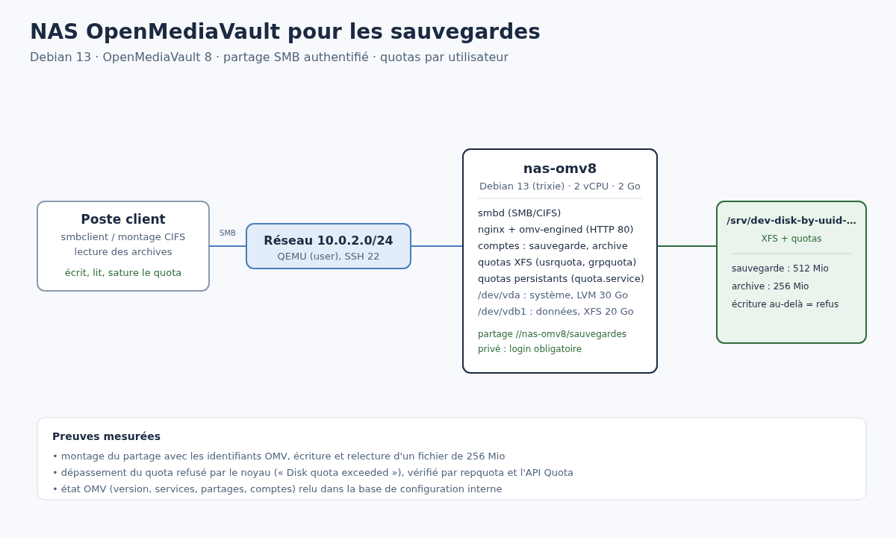
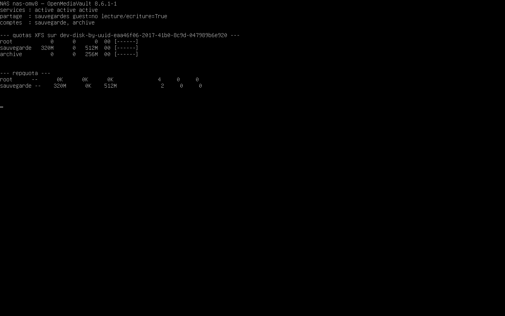
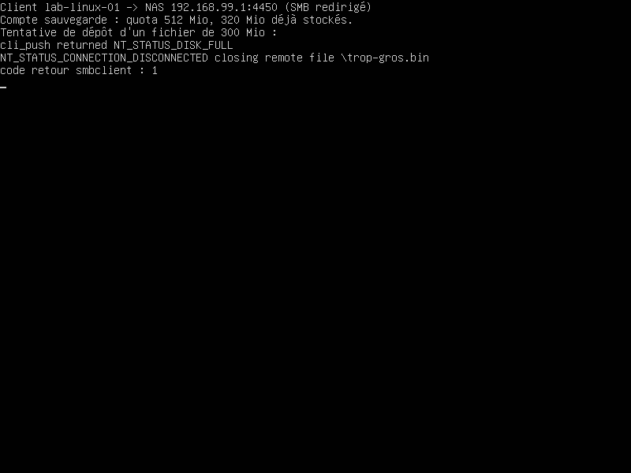
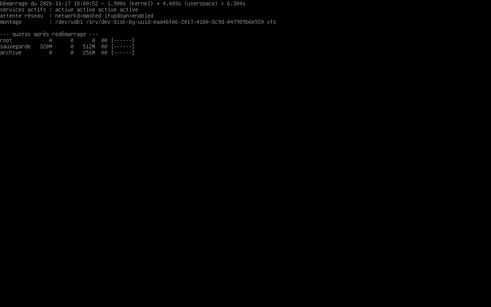
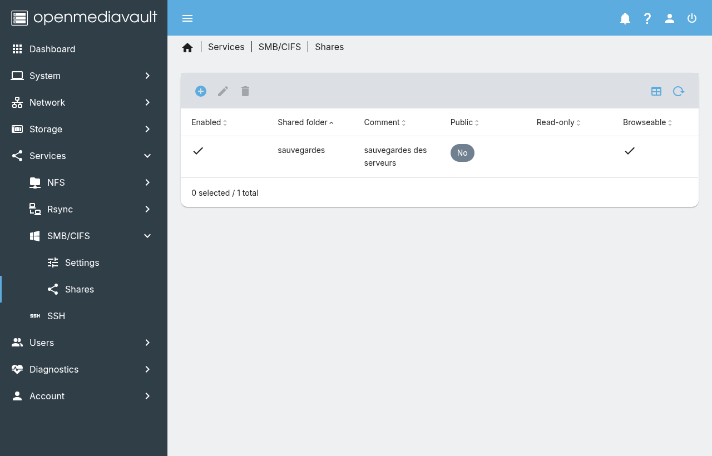
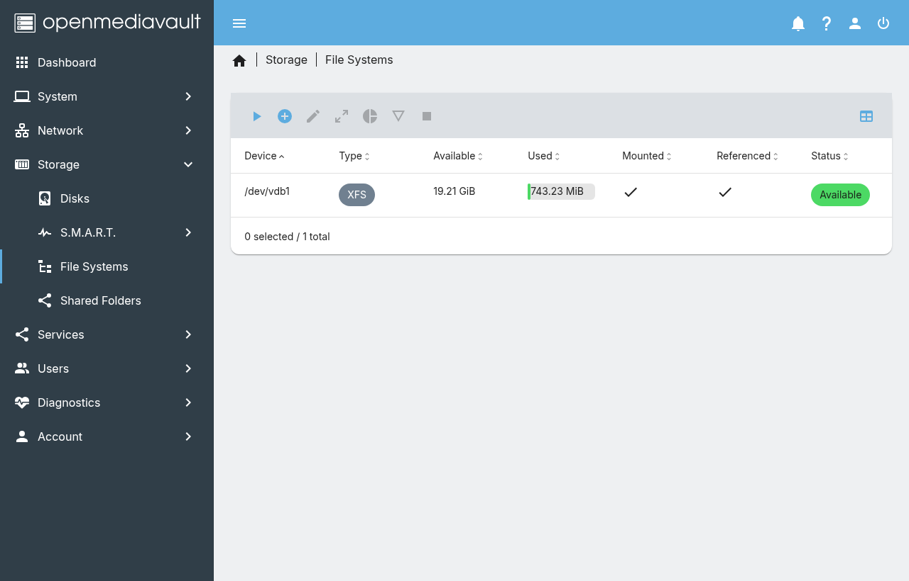

# Mettre en place un serveur NAS (OpenMediaVault ou TrueNAS) pour les sauvegardes

## Objectif

Un serveur de sauvegarde doit accepter les dépôts d'un client, mais pas se laisser
remplir par un seul compte. Ce projet installe OpenMediaVault 8 sur Debian 13 dans une
VM, expose un partage SMB privé et applique un quota par utilisateur : **512 Mio** pour
`sauvegarde`, **256 Mio** pour `archive`. La preuve est faite depuis une autre machine
du lab : dépôt et relecture d'un fichier de 256 Mio, montage CIFS, puis refus réel du
noyau (`NT_STATUS_DISK_FULL`) au-delà du quota.

## Environnement

| Élément | Détail |
|---|---|
| Hyperviseur | QEMU/KVM (VM jetable `nas-omv8`), client sur le parc VMware |
| Système | Debian 13.2 (trixie), noyau 6.12 |
| NAS | OpenMediaVault **8.6.1-1**, dépôt `synchrony` |
| Ressources | 2 vCPU, 2 Go de RAM |
| Disque système | `/dev/vda`, 30 Go, LVM (`root`, `var`, `home`, `tmp`, `swap`) |
| Disque données | `/dev/vdb`, 20 Go, partition XFS `/dev/vdb1` |
| Réseau | QEMU user 10.0.2.0/24 ; ports hôte 2223→22, 8080→80, 4450→445 |
| Client de test | `lab-linux-01`, 192.168.99.11, Ubuntu 22.04.5, smbclient 4.15.13, mount.cifs 6.14 |
| Comptes | `sauvegarde` (uid 1000), `archive` (uid 1001), groupe `users` |
| Mots de passe | `Sauvegarde2026` pour les comptes OMV, admin OMV remplacé ; les deux sont hors dépôt |

Le client ne joint pas le NAS sur le port 445 standard : QEMU redirige le port hôte
**4450** vers le 445 de l'invité, et la redirection est bindée sur `0.0.0.0` pour être
joignable depuis la VM VMware. SSH et l'interface web restent, eux, sur `127.0.0.1`.

## Architecture

Source : [`schemas/architecture.svg`](schemas/architecture.svg).

Le client se connecte en SMB 3.0. `smbd` authentifie l'utilisateur, puis sert le
dossier partagé `sauvegardes` situé sur le disque de données XFS. Ce système de
fichiers est monté avec `usrquota,grpquota` : le noyau lui-même refuse l'écriture qui
dépasserait la limite du compte, quelle que soit l'application utilisée (smbclient,
montage CIFS, script de sauvegarde).

## Étapes clés

1. Préparation de la VM et du disque de données
   ([`scripts/00-preparation.sh`](scripts/00-preparation.sh)) : nom d'hôte `nas-omv8`,
   table GPT sur `/dev/vdb`, partition unique. Le preseed d'installation est dans
   [`configs/preseed-nas-omv8.cfg`](configs/preseed-nas-omv8.cfg).
2. Installation d'OpenMediaVault depuis le dépôt officiel
   ([`scripts/01-installer-omv.sh`](scripts/01-installer-omv.sh)) : clé GPG, dépôt
   `synchrony`, `postfix` en « No configuration » pour éviter l'écran interactif.
3. Création du système de fichiers par l'API OMV
   (`FileSystemMgmt.create` sur **`/dev/vdb`**, pas sur la partition), puis montage
   avec `setMountPoint` : OMV ajoute `usrquota,grpquota,inode64` et monte le disque
   sous `/srv/dev-disk-by-uuid-eaa46f06-2017-41b0-8c9d-047989b6e920`.
4. Comptes, dossier partagé et privilèges : `UserMgmt.setUser` pour `sauvegarde` et
   `archive`, `ShareMgmt.set` pour le dossier `sauvegardes` (mode 775),
   `ShareMgmt.setPrivileges` en `perms=7` pour les deux comptes.
5. Service SMB (`Smb.setSettings`, `enable=true`) et partage privé
   (`Smb.setShare`, `guest=no`, `readonly=false`), puis `omv-salt deploy run samba`.
6. Quotas par utilisateur (`Quota.set`) et application par Salt
   (`omv-salt deploy run quota`) : `setquota` en blocs de 1 Kio, `quotaon`, service
   `quota` activé.
7. Tests réels depuis le client
   ([`scripts/02-test-smb-quotas.sh`](scripts/02-test-smb-quotas.sh),
   [`scripts/04-test-montage-cifs.sh`](scripts/04-test-montage-cifs.sh)) : énumération,
   dépôt, relecture, dépassement, montage CIFS.
8. Redémarrage et vérification de la persistance
   ([`scripts/07-corriger-demarrage.sh`](scripts/07-corriger-demarrage.sh),
   [`scripts/08-preuve-redemarrage.sh`](scripts/08-preuve-redemarrage.sh)) : les
   services montent seuls, les quotas et le partage survivent.

## Résultat prouvé

| Capture | Ce qu'elle montre |
|---|---|
|  | Console du NAS : OMV 8.6.1-1, `nginx`/`smbd`/`openmediavault-engined` actifs, partage `sauvegardes` privé en lecture/écriture, comptes `sauvegarde` et `archive`, puis `xfs_quota` et `repquota` avec **512 Mio utilisés sur 512** et 0 sur 256 |
|  | Depuis `lab-linux-01` : dépôt de 300 Mio supplémentaires refusé par le serveur, `cli_push returned NT_STATUS_DISK_FULL`, code retour `1` |
|  | Après redémarrage : boot en 6,3 s, les quatre services actifs sans intervention, `systemd-networkd-wait-online` masqué, disque monté et quotas intacts |
|  | Interface web OMV connectée : le partage `sauvegardes`, commentaire, **Public = No**, navigable |
|  | Interface web, stockage : `/dev/vdb1` en **XFS**, 19,21 Gio libres, monté, référencé, état *Available* |

| Mesure | Valeur |
|---|---|
| Dépôt d'un fichier de 256 Mio par SMB | **1,35 s** (~200 Mo/s), empreinte SHA-256 `a6d72ac7…` |
| Relecture et comparaison | empreinte identique, `cmp` sans différence |
| Écriture au-delà de 512 Mio | refusée : `NT_STATUS_DISK_FULL`, fichier laissé à 256 Mio (le quota exact) |
| Compte `archive` au-delà de 256 Mio | refusé de la même façon |
| Montage CIFS SMB 3.0 | `//192.168.99.1/sauvegardes` monté, `df` annonce **512 Mio** (la taille du quota, pas du disque) |
| Écriture à travers le montage | 64 Mio copiés, empreinte identique à la source |
| Écriture après redémarrage du NAS | 8 Mio déposés, relus, identiques |
| Démarrage du NAS après correctif | **6,3 s** (1,9 s noyau + 4,4 s userspace) |

Journaux complets :

- [`logs/01-preparation.txt`](logs/01-preparation.txt) — nom d'hôte, prérequis, partition
  GPT du disque de données.
- [`logs/02-installation-omv.txt`](logs/02-installation-omv.txt) — dépôt, installation,
  liens systemd posés par OMV.
- [`logs/03-test-smb-quotas.txt`](logs/03-test-smb-quotas.txt) — énumération, dépôt,
  relecture, refus des deux comptes, montage CIFS.
- [`logs/04-etat-quotas.txt`](logs/04-etat-quotas.txt) — `xfs_quota`, `repquota`, API
  `Quota`, contenu du partage, comptes et partages vus par OMV.
- [`logs/05-test-montage-cifs.txt`](logs/05-test-montage-cifs.txt) — écriture et
  relecture de 64 Mio à travers le montage.
- [`logs/06-demarrage-services.txt`](logs/06-demarrage-services.txt) — diagnostic du
  blocage de démarrage et correctif.
- [`logs/07-apres-redemarrage.txt`](logs/07-apres-redemarrage.txt) — services, montage
  et quotas après redémarrage.
- [`logs/08-apres-redemarrage-client.txt`](logs/08-apres-redemarrage-client.txt) —
  dépôt, relecture et suppression depuis le client après le redémarrage.
- [`logs/09-mot-de-passe-admin.txt`](logs/09-mot-de-passe-admin.txt) — mot de passe
  admin par défaut refusé après remplacement.

## Problèmes rencontrés

| Problème | Cause | Correctif |
|---|---|---|
| `FileSystemMgmt.create` sur `/dev/vdb1` échoue : `partprobe` ne peut pas relire la table, puis imbrique un GPT **dans** la partition | L'API attend un **disque**, pas une partition : elle exécute elle-même `sgdisk --new=1:0:0` puis `partprobe` | Passer `/dev/vdb` (le disque entier) et laisser OMV créer la partition et le XFS |
| `Missing 'required' attribute 'start'` sur `FileSystemMgmt.getList` | La méthode hérite du schéma `rpc.common.getlist`, qui exige une pagination | Envoyer `{"start":0,"limit":20}` |
| `Smb.setSettings` refuse la charge utile complète | Le schéma `rpc.smb.setsettings` n'accepte que **12 champs** (`homesrecyclebin`, `netbios`, `minprotocol`… sont en lecture seule) | N'envoyer que `enable`, `workgroup`, `serverstring`, `loglevel`, `usesendfile`, `aio`, `timeserver`, `winssupport`, `winsserver`, `homesenable`, `homesbrowseable`, `extraoptions` |
| Après chaque démarrage, `nginx` et `smbd` restaient **inactifs** et le boot ne finissait jamais | `systemd-networkd-wait-online` a `TimeoutStartUSec=infinity` et attend des liens que networkd ne gère pas (`unmanaged`) : le réseau est sous ifupdown. `network-online.target` n'était donc jamais atteint | `systemctl disable --now` **et** `mask systemd-networkd-wait-online`, puis activer `ifupdown-wait-online` : boot en 6,3 s, services actifs |
| `setquota` manuel affichait `512G` au lieu de `512M` | `setquota` compte en **blocs de 1 Kio** : `536870912` blocs = 512 Gio. Le sel Salt d'OMV, lui, avait bien posé `524288` blocs | Rejouer `setquota --user sauvegarde 0 524288 0 0 /dev/vdb1` et vérifier avec `xfs_quota report` |
| Un `put` interrompu par le quota laisse un fichier partiel de la taille exacte du quota | `smbclient` écrit le fichier au fil de l'eau ; le noyau refuse les blocs suivants mais ne supprime pas ce qui est déjà écrit | Supprimer les partiels (`fichier-300m.bin`, `archive-300m.bin`, `trop-gros.bin`) après le test ; le quota est immédiatement recrédité |
| La machine hôte a redémarré pendant la session : VM QEMU arrêtée brutalement, VM VMware éteintes, `/tmp/opencode` vidé | Redémarrage du poste de travail, hors du contrôle du lab | Redémarrer la VM, vérifier l'intégrité du disque (`xfs_quota`, contenu du partage), refaire les captures perdues. Tout a survécu : quotas et fichiers intacts |
| `omv-rpc UserMgmt setUser` renvoie le mot de passe **en clair** dans sa réponse | L'API renvoie l'objet complet, y compris le champ `password` | Ne jamais journaliser cette sortie ; les mots de passe sont lus depuis `/root/.labpass` et absents du dépôt |
| Le bandeau « Changements de configuration en attente » restait affiché alors que `Config.isDirty` valait `false` | Le front ne se rafraîchit pas après un déploiement déclenché par l'API | Recharger la page : le bandeau disparaît, aucun changement n'était réellement en attente |
| `nginx` inactif juste après l'installation d'OMV | Même cause que le blocage de démarrage : le service attend `network-online.target` | `systemctl start nginx`, puis correction définitive du point ci-dessus |

## Durée et publication

- Durée : environ 3 h de travail effectif, étalées sur deux jours à cause de deux
  redémarrages de la machine hôte et de la remise en route du lab.
- Post LinkedIn : à venir.
- Auteur : [Jenovi Dandou](https://www.linkedin.com/in/jenovi-dandou).
