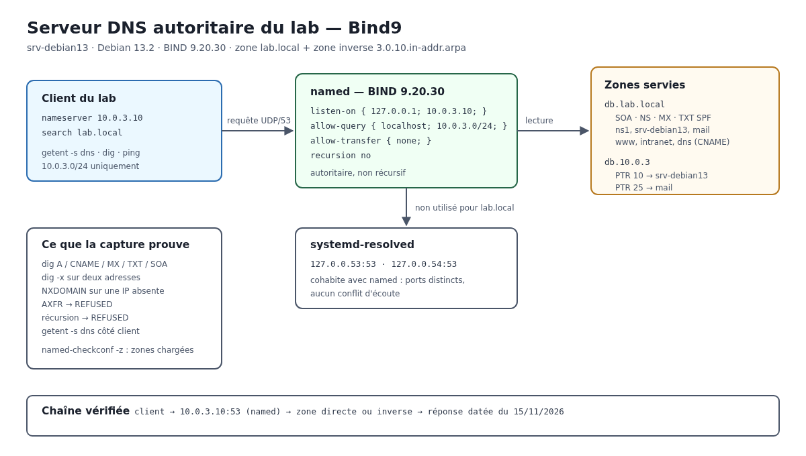
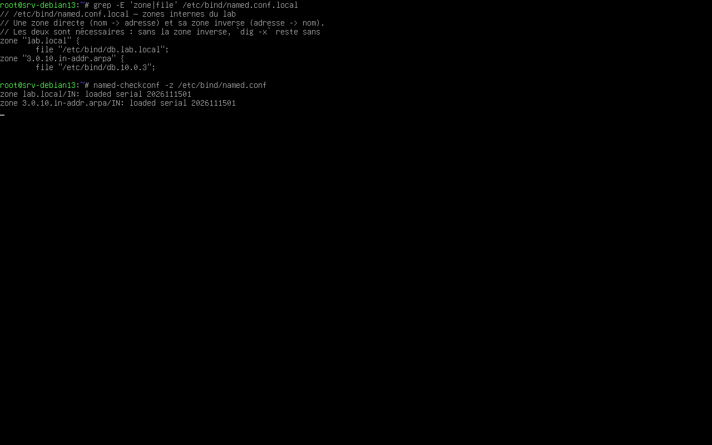
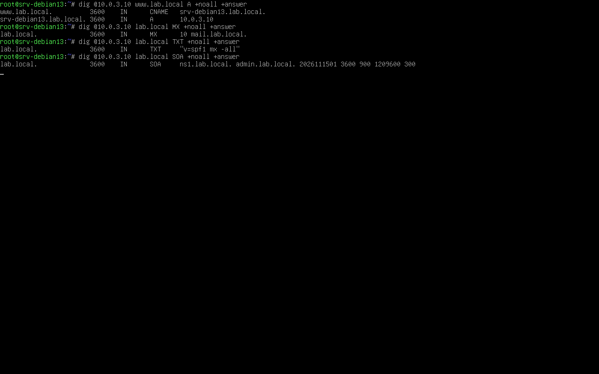
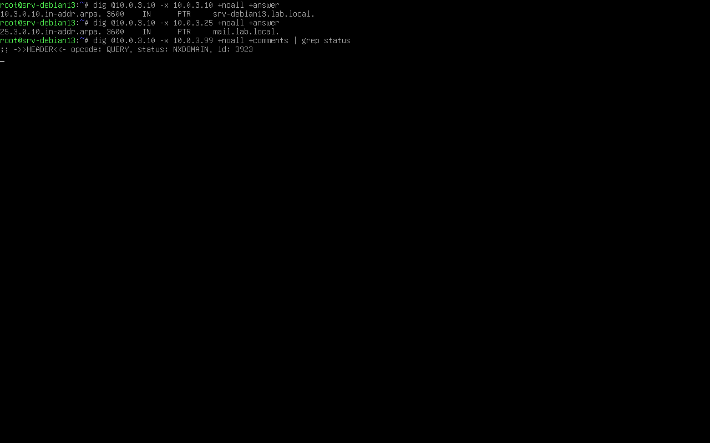
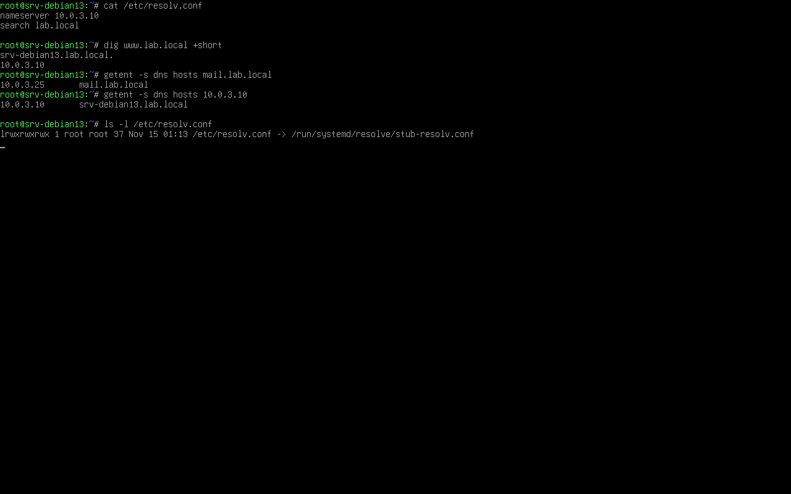
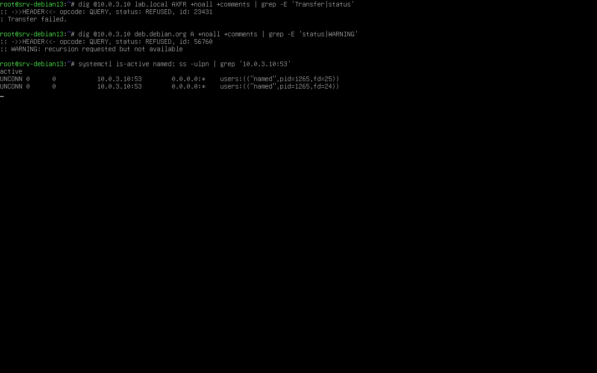

# Serveur DNS local avec Bind9 : zones directe et inverse

## Objectif

Rendre le serveur `srv-debian13` autoritaire pour le domaine interne `lab.local` :
résoudre les noms du lab vers leurs adresses, et faire l'inverse (adresse → nom) pour
que les journaux et les outils affichent des noms lisibles. Le serveur doit répondre
uniquement au réseau du lab, refuser les transferts de zone et ne pas servir de
résolveur récursif ouvert.

## Environnement

| Élément | Détail |
|---|---|
| Hyperviseur | QEMU/KVM, machine `srv-debian13` |
| Système | Debian GNU/Linux 13.2 « trixie », noyau 6.12.57+deb13-amd64 |
| Logiciels | BIND 9.20.30-1~deb13u1 (`bind9`, `bind9utils`, `dnsutils`) |
| Adresse du serveur | `10.0.3.10/24` sur `ens4`, réseau du lab |
| Domaine | `lab.local`, zone inverse `3.0.10.in-addr.arpa` |
| Résolveur système | `systemd-resolved` sur `127.0.0.53` — conservé, sans conflit |

## Architecture

Source : [`schemas/architecture.svg`](schemas/architecture.svg).

## Étapes clés

1. Installation de `bind9`, `bind9utils` et `dnsutils`, puis sauvegarde des fichiers
   Debian d'origine (`named.conf.options.avant-lab`, `named.conf.local.avant-lab`).
2. [`configs/named.conf.options`](configs/named.conf.options) : écoute limitée à
   `127.0.0.1` et `10.0.3.10`, requêtes autorisées pour `localhost` et `10.0.3.0/24`,
   `allow-transfer { none; }`, `recursion no`, version masquée.
3. [`configs/named.conf.local`](configs/named.conf.local) : déclaration de la zone
   directe `lab.local` et de la zone inverse `3.0.10.in-addr.arpa`.
4. [`configs/db.lab.local`](configs/db.lab.local) : SOA, NS, MX, SPF, enregistrements A
   (`ns1`, `srv-debian13`, `mail`) et CNAME (`www`, `intranet`, `dns`).
5. [`configs/db.10.0.3`](configs/db.10.0.3) : les PTR de `10.0.3.10` et `10.0.3.25`,
   avec le même numéro de série que la zone directe.
6. Validation par `named-checkconf -z` et `named-checkzone` **avant** le redémarrage,
   puis `systemctl restart named`.
7. Test côté client réalisé par
   [`scripts/tester-client.sh`](scripts/tester-client.sh) : bascule temporaire de
   `/etc/resolv.conf` sur `10.0.3.10`, résolution directe et inverse, restauration du
   résolveur systemd.

Script de déploiement : [`scripts/deployer-dns.sh`](scripts/deployer-dns.sh).

## Résultat prouvé

| Capture | Ce qu'elle montre |
|---|---|
|  | Les deux zones déclarées et `named-checkconf -z` qui les charge sans erreur (série `2026111501`) |
|  | `www` renvoie le CNAME puis l'A `10.0.3.10`, plus MX, TXT SPF et SOA de `lab.local` |
|  | `dig -x` sur `10.0.3.10` et `10.0.3.25` renvoie les PTR attendus, et `10.0.3.99` répond `NXDOMAIN` |
|  | Un client configuré sur `10.0.3.10` résout `www.lab.local`, `mail.lab.local` et l'inverse de `10.0.3.10`, puis retrouve le résolveur systemd |
|  | `AXFR` et une requête récursive sont refusés (`REFUSED`), `named` écoute bien sur `10.0.3.10:53` |

Journaux :

- [`logs/02-installation-bind9.txt`](logs/02-installation-bind9.txt) — installation et
  version installée.
- [`logs/03-deploiement.txt`](logs/03-deploiement.txt) — déploiement complet, code 0.
- [`logs/04-tests-dig.txt`](logs/04-tests-dig.txt) — requêtes directes et inverses.
- [`logs/05-client-et-refus.txt`](logs/05-client-et-refus.txt) — refus de transfert et
  de récursion.
- [`logs/06-client-getent.txt`](logs/06-client-getent.txt) — test client complet.
- [`logs/07-persistance.txt`](logs/07-persistance.txt) — après redémarrage de la VM :
  `named` actif, zone directe et inverse toujours servies.

## Problèmes rencontrés

| Problème | Cause | Correctif |
|---|---|---|
| `getent hosts www.lab.local` renvoyait `127.0.1.1` au lieu de `10.0.3.10`, même avec `resolv.conf` pointé sur Bind9 | `nsswitch.conf` de Debian place `files myhostname resolve` **avant** `dns` ; le module `resolve` parle à systemd-resolved, qui ne connaît pas `lab.local`, et la requête n'atteint jamais Bind9 | Utiliser `getent -s dns hosts`, qui force le module DNS ; c'est ce que fait le script client |
| Après le test, `resolv.conf` risquait de rester modifié | `/etc/resolv.conf` est un lien vers `/run/systemd/resolve/stub-resolv.conf` : `cat > /etc/resolv.conf` écrit **à travers** le lien, donc dans le fichier de systemd-resolved | Le script supprime le lien, écrit un fichier normal, puis restaure le lien depuis une copie (`cp -a` + `mv`), avec un `trap EXIT` pour restaurer même en cas d'erreur |

## Durée et publication

- Durée : environ 40 minutes.
- Post LinkedIn : à venir.
