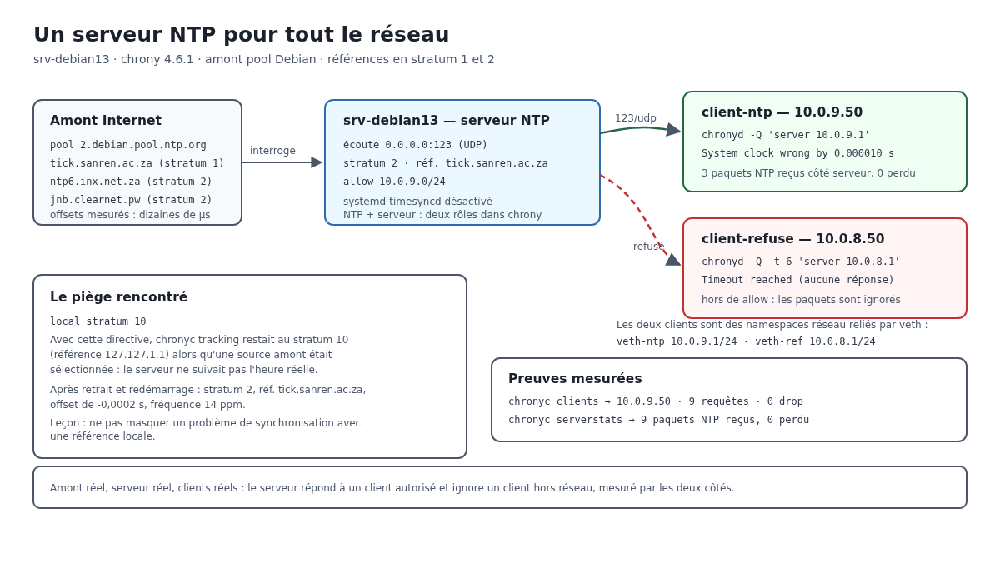
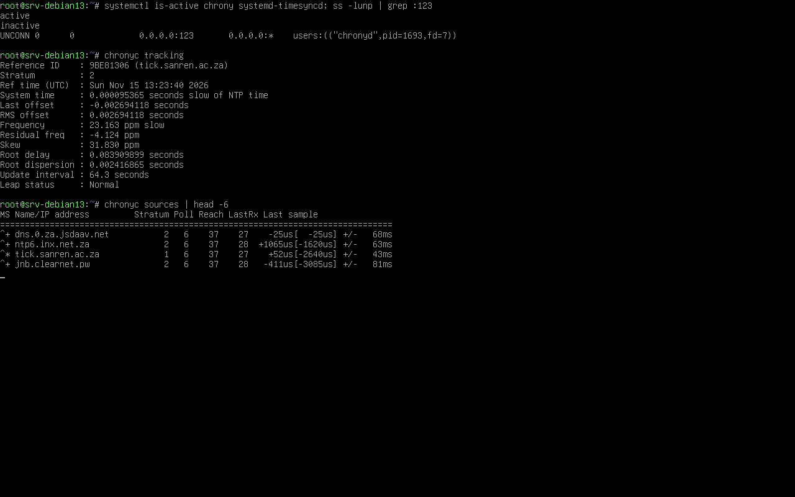
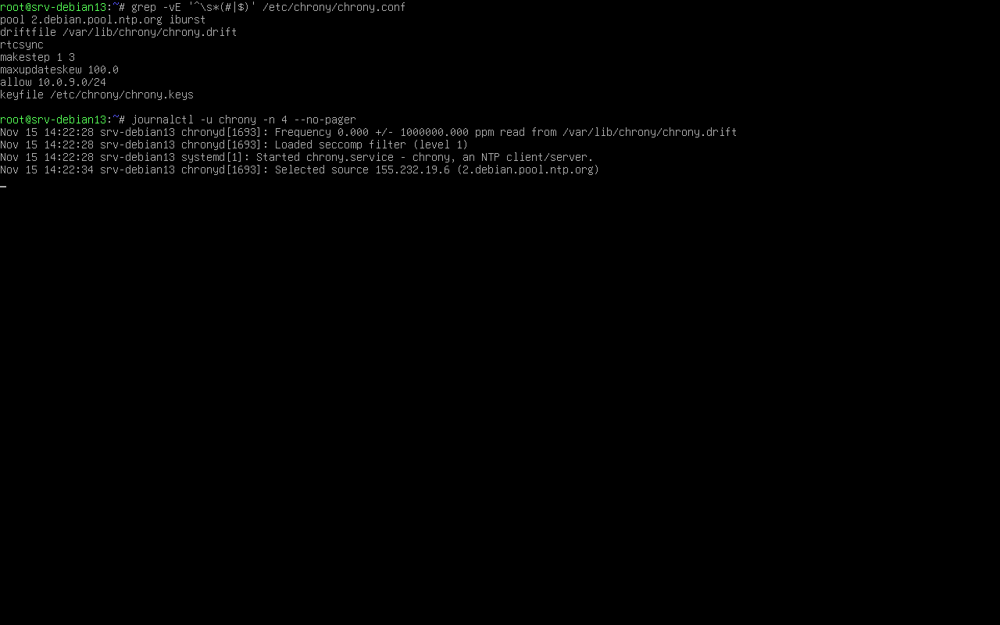
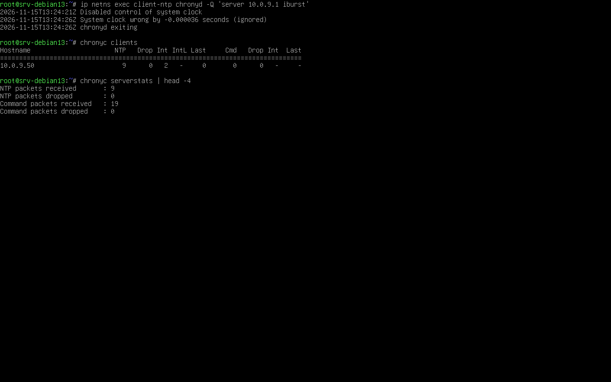
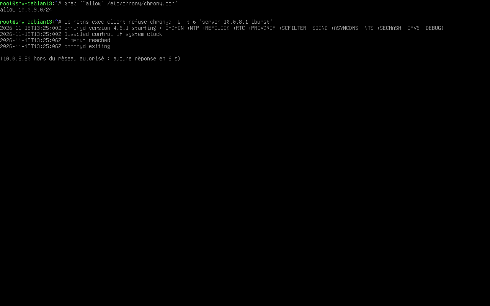

# Mettre en place un serveur NTP pour tout le réseau

## Objectif

Faire de `srv-debian13` le serveur de temps du lab : synchronisé sur des sources
Internet réelles, il doit servir l'heure aux machines du réseau autorisé et refuser
les autres. Le projet vérifie les deux côtés — ce que le serveur répond et ce que le
client mesure — avec de vrais échanges NTP sur UDP 123, pas une simple relecture de
configuration. Projet tiré au hasard dans le catalogue (`08-358`).

## Environnement

| Élément | Détail |
|---|---|
| Hyperviseur | QEMU/KVM, machine `srv-debian13` |
| Système | Debian GNU/Linux 13.2 « trixie » |
| Logiciel | chrony 4.6.1 (`chronyd` + `chronyc`), `systemd-timesyncd` désactivé |
| Amont | `pool 2.debian.pool.ntp.org` (références en stratum 1 et 2) |
| Serveur | écoute `0.0.0.0:123/udp`, `allow 10.0.9.0/24` |
| Clients | namespaces `client-ntp` (10.0.9.50) et `client-refuse` (10.0.8.50), reliés par veth |
| Réseau du lab | `10.0.3.10/24` (ens4) + `10.0.2.15/24` (ens3, sortie Internet) |

## Architecture

Source : [`schemas/architecture.svg`](schemas/architecture.svg).

## Étapes clés

1. État des lieux : `timedatectl` indique un service NTP actif mais aucune
   synchronisation, `chronyd` est absent et c'est `systemd-timesyncd` qui occupe le
   rôle (aucun socket UDP 123).
2. Installation de chrony et désactivation de `systemd-timesyncd`
   ([`scripts/01-installer-chrony.sh`](scripts/01-installer-chrony.sh)).
3. Configuration du serveur ([`configs/chrony.conf`](configs/chrony.conf)) : pool
   amont, `allow 10.0.9.0/24`, driftfile, `rtcsync`, `makestep`.
4. Premier essai avec `local stratum 10` : le serveur reste sur sa référence locale
   (stratum 10) au lieu de suivre l'amont. Retrait de la directive, redémarrage,
   convergence en 20 s.
5. Vérification côté serveur : `chronyc tracking`, `chronyc sources`,
   `chronyc serverstats`, `ss -lunp | grep :123`.
6. Création de deux LAN de test en namespaces (`veth-ntp` 10.0.9.1/24,
   `veth-ref` 10.0.8.1/24) et d'un client dans chacun.
7. Requête NTP réelle depuis le client autorisé avec `chronyd -Q`, puis depuis le
   client hors réseau autorisé, avec `-t 6` pour borner l'attente.

Scripts exécutés : [`scripts/02-configurer-serveur-ntp.sh`](scripts/02-configurer-serveur-ntp.sh),
[`scripts/03-corriger-et-verifier.sh`](scripts/03-corriger-et-verifier.sh),
[`scripts/04-tester-clients.sh`](scripts/04-tester-clients.sh).

## Résultat prouvé

| Capture | Ce qu'elle montre |
|---|---|
|  | `chrony` actif, `systemd-timesyncd` inactif, écoute sur `0.0.0.0:123`, `stratum 2` avec `tick.sanren.ac.za` comme référence et les quatre sources amont avec leurs offsets |
|  | Le fichier actif : pool amont, `driftfile`, `rtcsync`, `makestep 1 3`, `allow 10.0.9.0/24`, `keyfile` — et le journal qui montre la source sélectionnée |
|  | `chronyd -Q` depuis 10.0.9.50 : offset mesuré de -0.000036 s ; `chronyc clients` liste 10.0.9.50 avec 9 requêtes et 0 rejet ; `serverstats` confirme 9 paquets NTP reçus |
|  | `allow 10.0.9.0/24` et, depuis 10.0.8.50, `Timeout reached` après 6 s : le serveur ignore les paquets hors réseau autorisé |

Journaux :

- [`logs/01-etat-initial.txt`](logs/01-etat-initial.txt) — temps, NTP actif mais non
  synchronisé, interfaces et sortie Internet.
- [`logs/02-outils-temps.txt`](logs/02-outils-temps.txt) — `chronyd` absent,
  `systemd-timesyncd` actif, aucun socket UDP 123.
- [`logs/03-installation-chrony.txt`](logs/03-installation-chrony.txt) —
  installation de chrony 4.6.1 et bascule des services.
- [`logs/04-serveur-ntp.txt`](logs/04-serveur-ntp.txt) — configuration avec
  `local stratum 10` : le serveur reste au stratum 10.
- [`logs/05-correction-stratum.txt`](logs/05-correction-stratum.txt) — après retrait
  de la directive : stratum 2, offsets réels.
- [`logs/06-clients-ntp.txt`](logs/06-clients-ntp.txt) — client autorisé servi,
  client hors réseau refusé.

## Problèmes rencontrés

| Problème | Cause | Correctif |
|---|---|---|
| Aucun serveur NTP local alors que `timedatectl` annonçait « NTP service: active » | C'était `systemd-timesyncd`, un client seulement : il règle l'heure mais n'écoute pas sur UDP 123 | Installer chrony, le configurer en client **et** serveur, puis désactiver `systemd-timesyncd` |
| `chronyc tracking` restait au stratum 10 avec une référence `127.127.1.1` alors que des sources amont étaient sélectionnées | `local stratum 10` fournit une référence locale toujours disponible ; le serveur servait cette référence au lieu de suivre l'amont | Retirer la directive, redémarrer chrony et attendre la convergence : stratum 2 et offset réel |
| Depuis le client hors réseau, aucune réponse et aucun message explicite côté serveur | La directive `allow 10.0.9.0/24` filtre en amont : les paquets de 10.0.8.0/24 sont ignorés silencieusement, le client ne voit qu'un délai dépassé | C'est le comportement voulu ; le prouver côté client avec `-t 6`, et côté serveur avec `chronyc clients` / `serverstats` |

## Durée et publication

- Durée : environ 45 minutes.
- Post LinkedIn : à venir.
- Auteur : [Jenovi Dandou](https://www.linkedin.com/in/jenovi-dandou).
