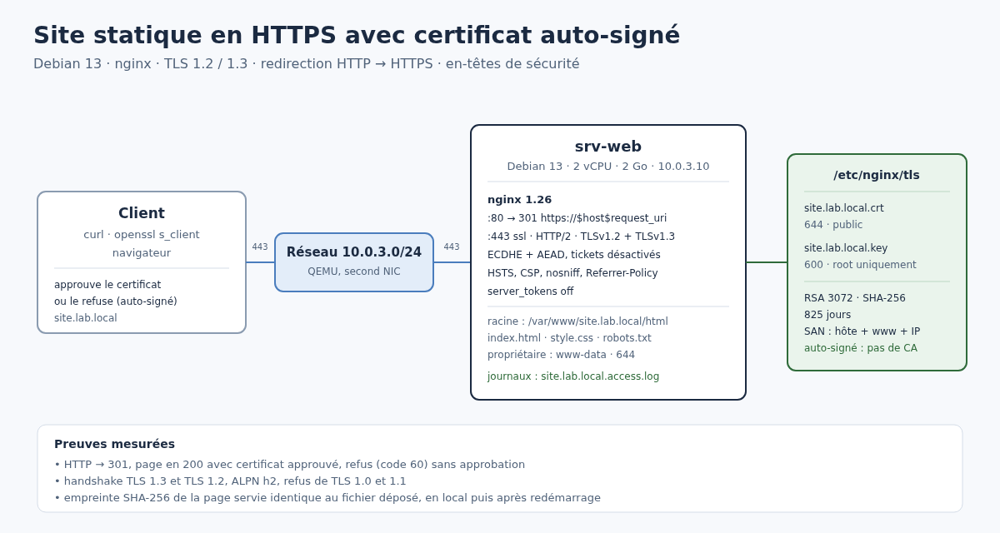
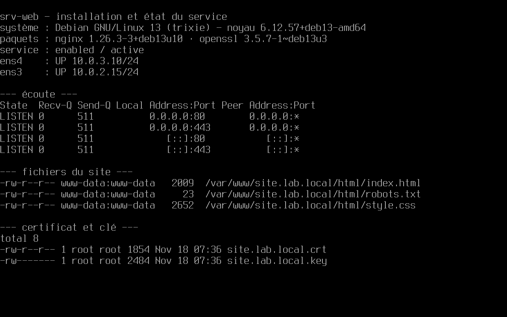
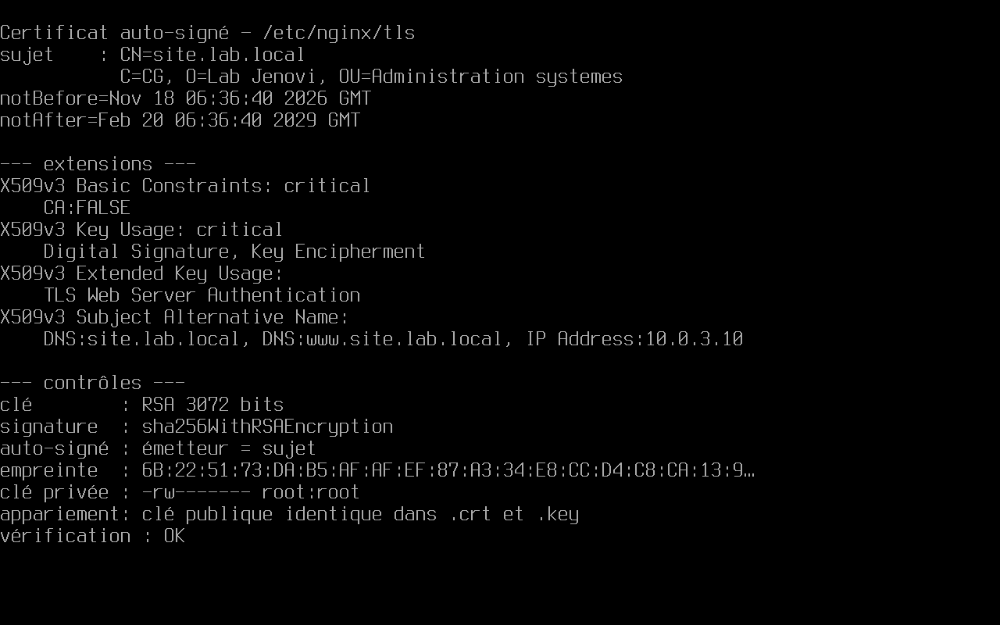
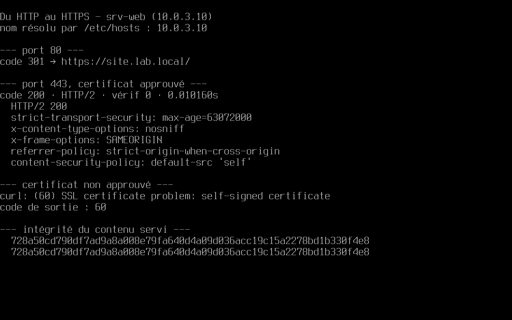
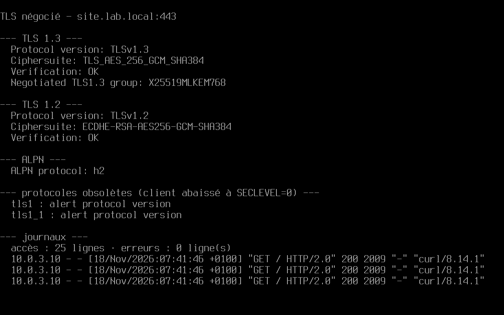
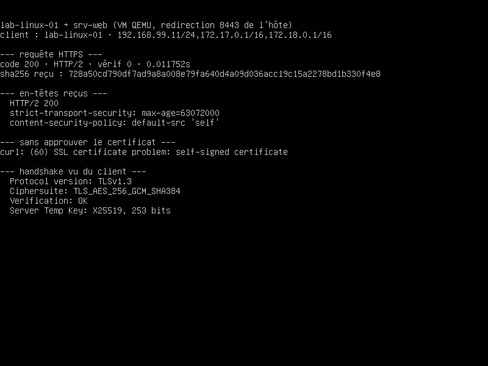
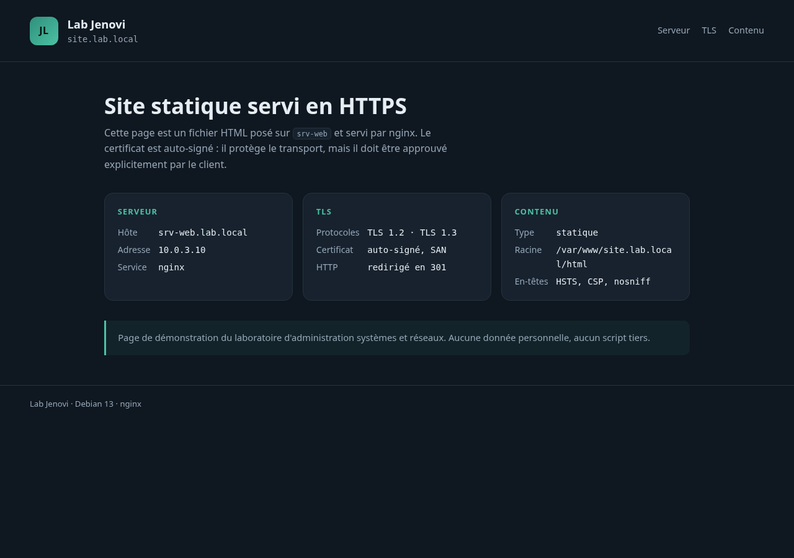
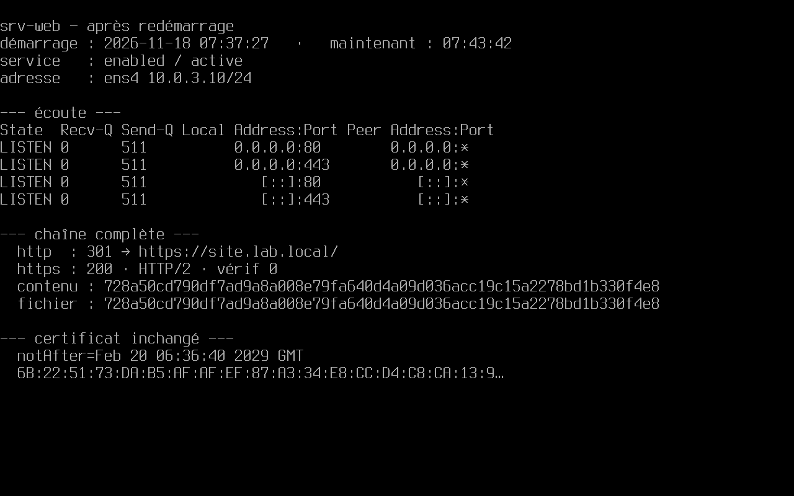

# Installer Nginx et configurer un site statique avec HTTPS

## Objectif

Servir un site statique depuis `srv-web` en n'acceptant que du HTTPS : le port 80
redirige en 301, le port 443 négocie TLS 1.2 ou 1.3 et refuse les protocoles
obsolètes. Le certificat est auto-signé, ce qui oblige à traiter explicitement la
question de la confiance : ce qui se passe quand le client l'accepte, et ce qui se
passe quand il ne l'accepte pas.

## Environnement

| Élément | Détail |
|---|---|
| Hyperviseur | QEMU/KVM, machine `srv-web` (VM jetable, 2 vCPU, 2 Go) |
| Système | Debian GNU/Linux 13.2 « trixie », noyau 6.12.57+deb13-amd64 |
| Logiciels | nginx 1.26.3-3+deb13u10, OpenSSL 3.5.7-1~deb13u3 |
| Adresse du serveur | `10.0.3.10/24` sur `ens4`, réseau du lab |
| Accès depuis l'hôte | `ens3` en NAT `10.0.2.15`, redirections `8080→80` et `8443→443` |
| Client du parc | `lab-linux-01`, `192.168.99.11`, accès par `192.168.99.1:8443` |
| Nom du site | `site.lab.local` et `www.site.lab.local` |

## Architecture

Source : [`schemas/architecture.svg`](schemas/architecture.svg).

## Étapes clés

1. Installation de `nginx` et vérification de l'état du service
   ([`logs/01-etat-initial.txt`](logs/01-etat-initial.txt)).
2. Clé RSA 3072 bits et certificat auto-signé de 825 jours, avec les trois noms
   dans le SAN (`site.lab.local`, `www.site.lab.local`, `10.0.3.10`) —
   [`configs/openssl-san.cnf`](configs/openssl-san.cnf),
   [`scripts/02-certificat.sh`](scripts/02-certificat.sh). La clé est en `600 root:root`,
   le certificat en `644`.
3. Site statique dans `/var/www/site.lab.local/html` — une page, une feuille de
   style, un `robots.txt`, propriétaire `www-data`
   ([`configs/site/index.html`](configs/site/index.html),
   [`configs/site/style.css`](configs/site/style.css)).
4. Hôte virtuel [`configs/site.lab.local.conf`](configs/site.lab.local.conf) :
   `return 301` sur le port 80, `http2 on` et TLS 1.2/1.3 sur le port 443, suites
   ECDHE + AEAD, tickets de session désactivés, en-têtes HSTS, CSP, `nosniff`,
   `SAMEORIGIN` et `Referrer-Policy`. Le site Debian par défaut est désactivé après
   sauvegarde ([`scripts/03-deployer-site.sh`](scripts/03-deployer-site.sh)).
5. Batterie de tests en local : redirection, page en 200 sur HTTP/2, refus sans
   approbation, en-têtes, empreinte du contenu servi, handshakes TLS 1.3 et 1.2,
   ALPN, refus de TLS 1.0 et 1.1 ([`scripts/04-tests-tls.sh`](scripts/04-tests-tls.sh)).
6. Redémarrage de la VM : le service, l'adresse fixe et le certificat reviennent
   sans intervention ([`scripts/05-persistance.sh`](scripts/05-persistance.sh)).
7. Test depuis un autre poste : `lab-linux-01` récupère la page par le réseau du
   parc, avec le certificat copié à la main
   ([`scripts/06-client-distant.sh`](scripts/06-client-distant.sh)).

## Résultat prouvé

| Capture | Ce qu'elle montre |
|---|---|
|  | `srv-web` en Debian 13, nginx activé et actif, écoute sur 80 et 443 en IPv4 et IPv6, les trois fichiers du site avec leurs droits, le certificat et la clé en place |
|  | CN `site.lab.local`, validité du 18/11/2026 au 20/02/2029, `CA:FALSE`, usage serveur TLS, SAN avec les deux noms et l'adresse IP, RSA 3072, empreinte SHA-256, clé publique identique dans le `.crt` et le `.key` |
|  | Port 80 : `301` vers `https://site.lab.local/` ; port 443 : `200` en HTTP/2 avec les cinq en-têtes de sécurité ; sans approbation du certificat, `curl` s'arrête en `60` ; l'empreinte de la page servie est celle du fichier déposé |
|  | TLS 1.3 en `TLS_AES_256_GCM_SHA384` avec le groupe hybride `X25519MLKEM768`, TLS 1.2 en `ECDHE-RSA-AES256-GCM-SHA384`, ALPN `h2`, et `alert protocol version` pour TLS 1.0 comme pour TLS 1.1 |
|  | Depuis `lab-linux-01` : `200` en HTTP/2, même empreinte `728a50cd…f4e8`, en-têtes reçus, refus en `60` sans le certificat, handshake TLS 1.3 vu du client |
|  | La page réellement servie, rendue par Chromium : mise en page complète, feuille de style chargée depuis le serveur |
|  | Après redémarrage : nginx actif 3 secondes après le démarrage, adresse `10.0.3.10` revenue, `301` puis `200`, empreinte du contenu inchangée, certificat identique |

Journaux :

- [`logs/01-etat-initial.txt`](logs/01-etat-initial.txt) — état avant travaux, adresse
  fixe, installation de nginx.
- [`logs/01b-nom-hote.txt`](logs/01b-nom-hote.txt) — correction du nom d'hôte.
- [`logs/02-certificat.txt`](logs/02-certificat.txt) — génération et vérification du
  certificat.
- [`logs/03-deploiement.txt`](logs/03-deploiement.txt) — dépôt du site, activation de
  l'hôte virtuel, `nginx -t`, rechargement.
- [`logs/04-tests-tls.txt`](logs/04-tests-tls.txt) — les douze contrôles locaux.
- [`logs/05-persistance.txt`](logs/05-persistance.txt) — après redémarrage.
- [`logs/06-client-hote.txt`](logs/06-client-hote.txt) — test depuis l'hôte, par la
  redirection `8443`.
- [`logs/07-client-parc.txt`](logs/07-client-parc.txt) — test depuis `lab-linux-01`.
- [`logs/08-correction-carte.txt`](logs/08-correction-carte.txt) — correction du CSS et
  redéploiement du fichier.

## Problèmes rencontrés

| Problème | Cause | Correctif |
|---|---|---|
| La VM s'appelait `debian` alors que le preseed demandait `srv-web` | Le fichier de preseed est récupéré par `preseed/url` **après** que `netcfg` a configuré le réseau : la question du nom d'hôte était déjà répondue quand `netcfg/get_hostname` arrive, la valeur du fichier n'est donc jamais appliquée | [`scripts/01b-nom-hote.sh`](scripts/01b-nom-hote.sh) pose le nom après installation (`hostnamectl` + `/etc/hosts`) ; pour l'éviter, il faudrait passer `netcfg/get_hostname=` sur la ligne de commande du noyau |
| Le premier test TLS 1.0 et 1.1 ne prouvait rien du serveur | OpenSSL 3.5 refuse lui-même ces versions à son niveau de sécurité par défaut : le message `no protocols available` vient du client, qui n'envoie jamais de `ClientHello` | Refaire l'essai avec `-cipher 'DEFAULT@SECLEVEL=0'` : le client propose alors vraiment TLS 1.0/1.1 et le serveur répond `alert protocol version` (70), ce qui est la preuve cherchée |
| La carte « Contenu » de la page débordait de son cadre | Une valeur longue (`/var/www/site.lab.local/html`) dans une colonne `1fr` de grille sans césure possible : le texte sortait de la carte | `grid-template-columns: max-content minmax(0, 1fr)` et `overflow-wrap: anywhere` dans le CSS, puis redéploiement du seul fichier concerné — [`logs/08-correction-carte.txt`](logs/08-correction-carte.txt) |
| Les sorties de `nginx -v` et `nginx -t` apparaissaient à la fin des journaux | Ces deux commandes écrivent sur la sortie d'erreur, et le transcript enregistre d'abord la sortie standard | `2>&1` ajouté aux scripts concernés |
| Le journal d'accès contient des lignes `"\x15\x03\x03\x00\x02\x02F" 400` | Lors d'un refus de protocole, le client renvoie une alerte TLS que nginx journalise comme une requête malformée | Rien à corriger : c'est la trace normale du refus, et elle confirme que la connexion a bien été interrompue |

## Durée et publication

- Durée : environ 35 minutes, dont 7 minutes d'installation de la VM.
- Post LinkedIn : à venir.
