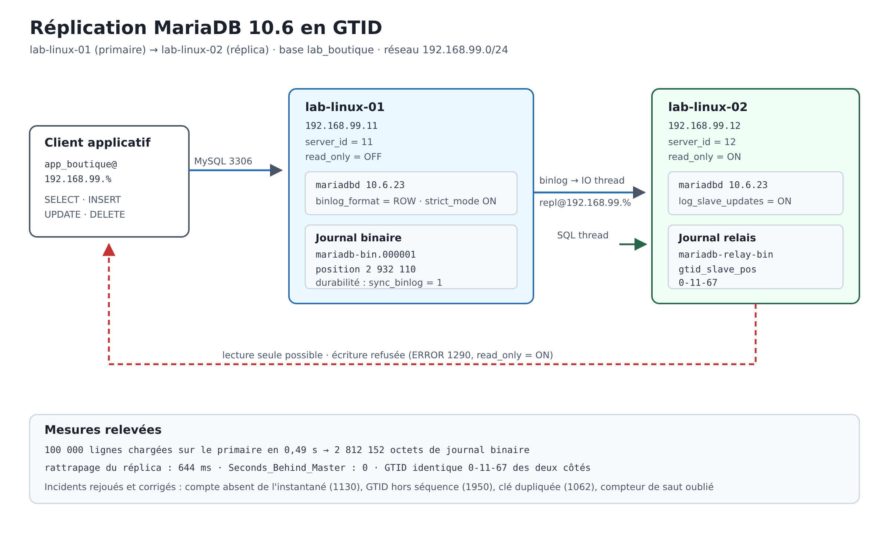
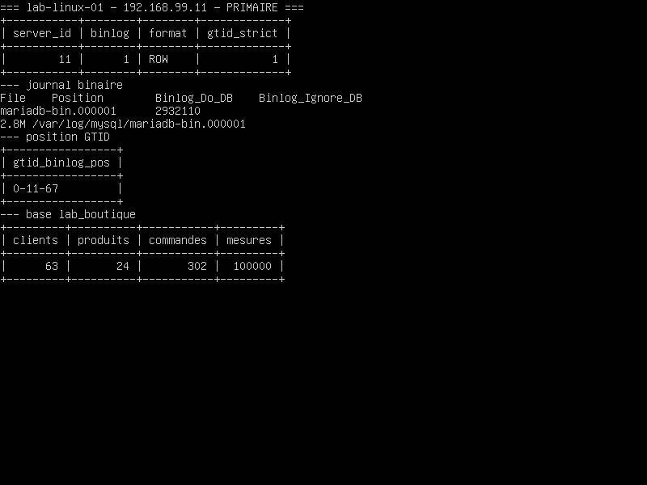
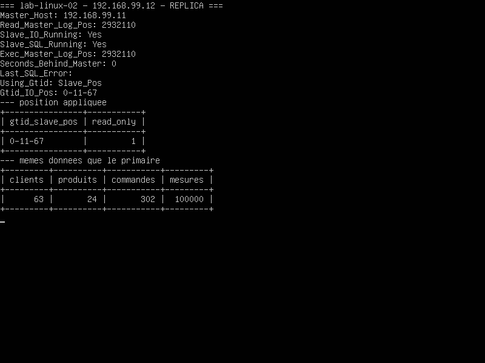
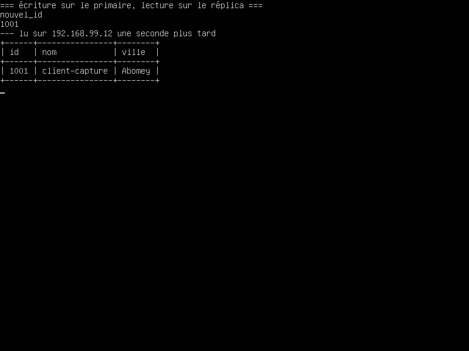
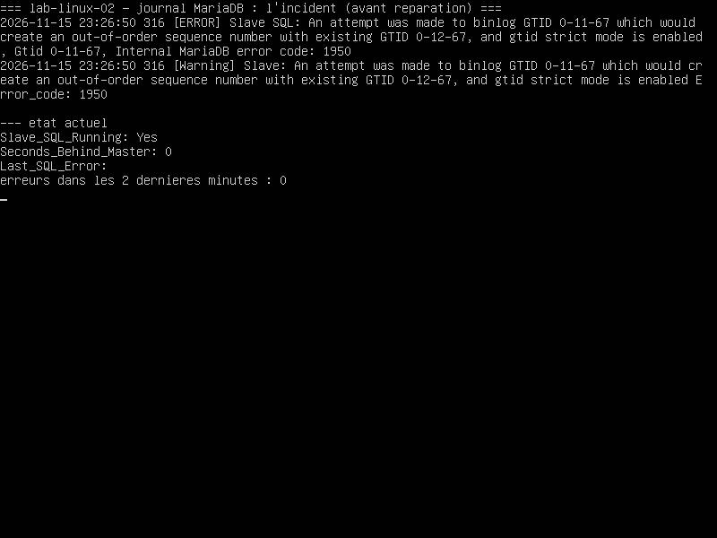

# Mettre en place un serveur de base de données MariaDB avec réplication

## Objectif

Faire tourner une base MariaDB sur deux machines, où tout ce qui est écrit sur le
primaire est rejoué sur le réplica en quelques centièmes de seconde, sans intervention.
Le projet vérifie le mécanisme de bout en bout : écriture applicative réelle sur
`192.168.99.11`, lecture de la même ligne sur `192.168.99.12`, mesure du retard sous
une charge de 100 000 lignes. Les incidents classiques de la réplication GTID sont
provoqués, diagnostiqués et corrigés, avec leurs journaux.

## Environnement

| Élément | Détail |
|---|---|
| Hyperviseur | VMware Workstation 25.0.1, deux VM du parc |
| Primaire | `lab-linux-01`, 192.168.99.11, 2 vCPU, 2 932 Mo, `server_id = 11` |
| Réplica | `lab-linux-02`, 192.168.99.12, 2 vCPU, `server_id = 12` |
| Système | Ubuntu 22.04.5 LTS, noyau 5.15.0-203 |
| Base | MariaDB 10.6.23 (paquets Ubuntu), port 3306 |
| Réplication | GTID (`MASTER_USE_GTID=slave_pos`), `binlog_format = ROW`, `gtid_strict_mode = ON` |
| Base applicative | `lab_boutique` : `clients`, `produits`, `commandes`, `lignes_commande` |
| Charge de mesure | table `mesures`, 100 000 lignes insérées en une transaction |
| Comptes | `app_boutique` (DML) et `repl` (réplication), mots de passe hors dépôt |

Le réplica est en `read_only = ON` : un client peut y lire, mais pas y écrire. Sur
MariaDB, `read_only` ne s'applique pas aux comptes qui ont le privilège `SUPER` —
c'est ce détail qui provoque l'incident GTID raconté plus bas.

## Architecture

Source : [`schemas/architecture.svg`](schemas/architecture.svg).

Le primaire écrit chaque transaction dans son journal binaire avec un identifiant
global `0-11-N`. Le réplica se connecte avec le compte `repl`, récupère ce journal
(thread d'E/S), le pose dans son journal relais, puis l'applique (thread SQL). Comme
`log_slave_updates = ON`, il journalise aussi ce qu'il applique : il pourra être promu
primaire sans perte.

## Étapes clés

1. Configuration des deux nœuds
   ([`configs/60-lab-replication-primaire.cnf`](configs/60-lab-replication-primaire.cnf),
   [`configs/60-lab-replication-replica.cnf`](configs/60-lab-replication-replica.cnf)) :
   `server_id` distinct, `log_bin`, `binlog_format = ROW`, `gtid_strict_mode = ON`,
   `sync_binlog = 1`, `read_only = ON` côté réplica.
2. Création de la base applicative, des comptes et de l'instantané initial
   ([`scripts/01-preparer-primaire.sh`](scripts/01-preparer-primaire.sh)) : 60 clients,
   24 produits, 300 commandes, 900 lignes de commande, puis
   `mariadb-dump --single-transaction --master-data=2 --gtid`.
3. Restauration sur le réplica
   ([`scripts/02-restaurer-replica.sh`](scripts/02-restaurer-replica.sh)) : la position
   GTID que `mariadb-dump` écrit en commentaire est appliquée à la main, sinon le
   réplica rejoue le journal depuis le début.
4. Branchement et démarrage
   ([`scripts/03-demarrer-replication.sh`](scripts/03-demarrer-replication.sh)) :
   `CHANGE MASTER TO ... MASTER_USE_GTID=slave_pos`, puis contrôle des deux threads.
5. Preuve applicative
   ([`scripts/04-ecrire-sur-primaire.sh`](scripts/04-ecrire-sur-primaire.sh),
   [`scripts/05-verifier-replica.sh`](scripts/05-verifier-replica.sh)) : une commande
   complète (client, commande, deux lignes, total recalculé) écrite avec le compte
   `app_boutique`, puis relue sur le réplica.
6. Mesure du retard
   ([`scripts/06-charge-100k.sql`](scripts/06-charge-100k.sql)) : le thread SQL du
   réplica est arrêté, le primaire charge 100 000 lignes en une transaction, puis le
   thread reprend et on chronomètre le rattrapage.

## Résultat prouvé

| Capture | Ce qu'elle montre |
|---|---|
|  | Le primaire : `server_id 11`, journal binaire actif en `ROW`, mode strict GTID, `mariadb-bin.000001` à 2 932 110 octets, position GTID `0-11-67`, et les volumes de `lab_boutique` |
|  | Le réplica : connecté à `192.168.99.11` avec le compte `repl`, `Using_Gtid: Slave_Pos`, `Slave_IO_Running: Yes`, `Slave_SQL_Running: Yes`, `Seconds_Behind_Master: 0`, aucune erreur, `read_only = 1`, et exactement les mêmes volumes |
|  | Une écriture faite sur `192.168.99.11` (`client-capture`, Abomey) relue une seconde plus tard sur `192.168.99.12` : la ligne existe des deux côtés |
|  | Le journal du réplica avec l'erreur réelle `An attempt was made to binlog GTID 0-11-67 ... out-of-order sequence number with existing GTID 0-12-67 ... error code: 1950`, puis l'état sain après réparation |

| Mesure | Valeur |
|---|---|
| Chargement de 100 000 lignes sur le primaire | **0,49 s** |
| Journal binaire produit | 119 656 → 2 931 808 octets, soit **2 812 152 octets** (~2,7 Mo) |
| Retard accumulé pendant que le thread SQL était arrêté | 2 812 152 octets de journal |
| Rattrapage complet après reprise du thread SQL | **644 ms** |
| `Seconds_Behind_Master` en régime normal | 0 |
| Position GTID à la fin | `0-11-67` des deux côtés |
| Lignes de `mesures` sur les deux nœuds | 100 000, mêmes bornes de dates |

Le réplica applique donc l'équivalent de 2,7 Mo de journal en 644 ms : sur ce volume,
la réplication n'est pas le facteur limitant.

Journaux complets :

- [`logs/01-etat-initial.txt`](logs/01-etat-initial.txt) — état des deux nœuds avant
  configuration : `server_id = 1` partout, `log_bin = OFF`, `bind_address = 127.0.0.1`.
- [`logs/02-configuration.txt`](logs/02-configuration.txt) — application des fichiers
  de configuration, redémarrage, variables effectives et premier journal binaire.
- [`logs/03-primaire.txt`](logs/03-primaire.txt) — schéma, jeu de données, comptes
  (mots de passe masqués), instantané cohérent et position GTID annoncée.
- [`logs/04-restauration-replica.txt`](logs/04-restauration-replica.txt) — restauration
  du dump et application manuelle de `gtid_slave_pos = 0-11-56`.
- [`logs/05-demarrage-replication.txt`](logs/05-demarrage-replication.txt) —
  `CHANGE MASTER` et premier état des threads.
- [`logs/06-preuve-replication.txt`](logs/06-preuve-replication.txt) — première preuve,
  avec l'erreur 1130 au passage.
- [`logs/07-incident-1130.txt`](logs/07-incident-1130.txt) — diagnostic de l'accès
  refusé : résolution de noms active, compte absent de la base `mysql`.
- [`logs/08-correctif-comptes.txt`](logs/08-correctif-comptes.txt) — recréation des
  comptes sur le primaire, répliqués automatiquement.
- [`logs/09-preuve-replication-finale.txt`](logs/09-preuve-replication-finale.txt) —
  preuve finale : écriture acceptée sur le primaire, relue sur le réplica, écriture
  refusée sur le réplica (`ERROR 1290`), GTID `0-11-63` alignés.
- [`logs/10-latence-charge.txt`](logs/10-latence-charge.txt) — charge de 100 000
  lignes, écart de journal, rattrapage chronométré.
- [`logs/11-incident-gtid.txt`](logs/11-incident-gtid.txt) — incident GTID hors
  séquence : erreur 1950, erreur 1236 après une réparation naïve, compteur de saut
  oublié, puis réparation propre.

## Problèmes rencontrés

| Problème | Cause | Correctif |
|---|---|---|
| `ERROR 1062 Duplicate entry '2-2' for key 'PRIMARY'` à la création du jeu de données | Deux modulo indépendants (`seq % 300` et `seq % 24`) produisent la même paire : le PPCM des deux périodes crée des doublons sur la clé composite | Générer les lignes en blocs : `commande_id = 1 + (seq - 1) DIV 24`, `produit_id = 1 + (seq - 1) % 24` — la clé devient unique par construction |
| `ERROR 1130 Host 'lab-linux-01' is not allowed to connect to this MariaDB server` | `mariadb-dump --databases lab_boutique` ne sauvegarde que cette base : les comptes vivent dans `mysql.user` et n'ont donc pas été restaurés | Rejouer `CREATE USER` et `GRANT` sur le primaire : ce sont des instructions journalisées, elles arrivent sur le réplica par la réplication elle-même |
| `ERROR 1950 ... binlog GTID 0-11-67 which would create an out-of-order sequence number with existing GTID 0-12-67` | Une écriture faite directement sur le réplica (`root` passe outre `read_only`) a créé une transaction locale `0-12-67`, en avance sur la séquence du primaire | Supprimer la ligne divergente, `RESET MASTER`, `SET GLOBAL gtid_slave_pos='0-11-66'`, redémarrer : le réplica rejoue la transaction du primaire |
| `ERROR 1236 ... connecting slave requested to start from GTID 0-12-67, which is not in the master's binlog` | Réparation naïve : la position GTID avait été calée sur l'identifiant local du réplica, que le primaire ne connaît pas | Repartir de la dernière position **du primaire** (`0-11-66`), jamais de celle du réplica |
| Le réplica a 62 clients alors que le primaire en a 63, sans aucune erreur | `SET GLOBAL sql_slave_skip_counter = 1` était resté en place : la transaction suivante a été sautée en silence, et le compteur retombe à 0 comme s'il n'avait jamais servi | Contrôler les compteurs après chaque incident ; remettre `gtid_slave_pos` à la position du primaire et rejouer la transaction |
| `ERROR 1046 No database selected` au lancement de la charge | Le fichier SQL ne contenait pas de `USE` et le client était appelé sans nom de base | Ajouter `USE lab_boutique;` en tête du script |

L'erreur `1290 The MariaDB server is running with the --read-only option` n'est pas un
incident : c'est le comportement attendu du réplica, et c'est cette preuve qui est
capturée.

## Durée et publication

- Durée : environ 1 h 30, dont une bonne partie à remonter l'incident GTID et à
  comprendre pourquoi une réparation qui « marche » peut sauter une transaction.
- Post LinkedIn : à venir.
- Auteur : [Jenovi Dandou](https://www.linkedin.com/in/jenovi-dandou).
