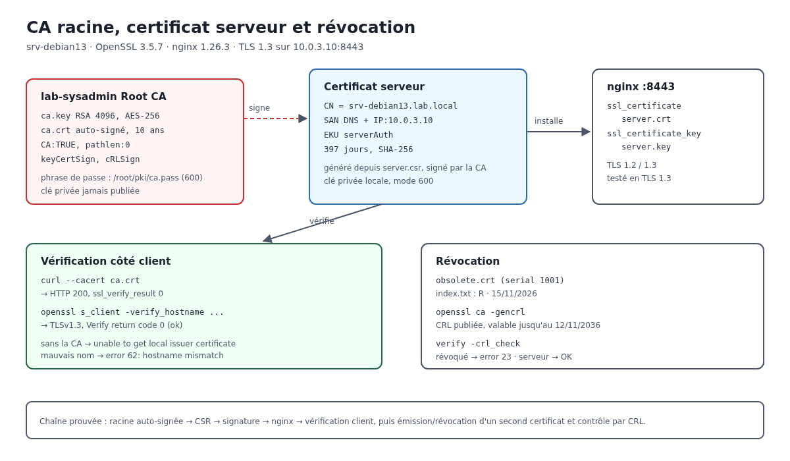
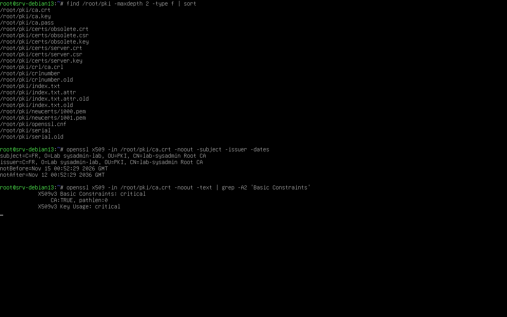
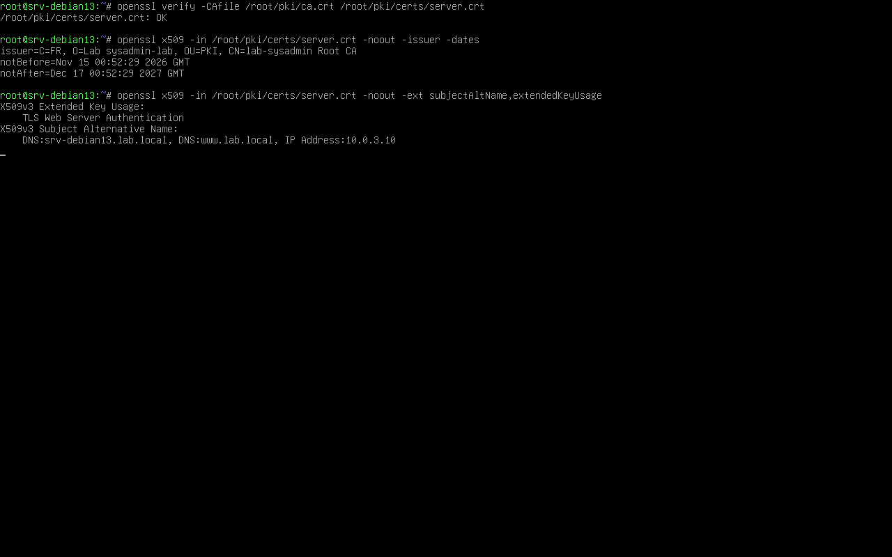
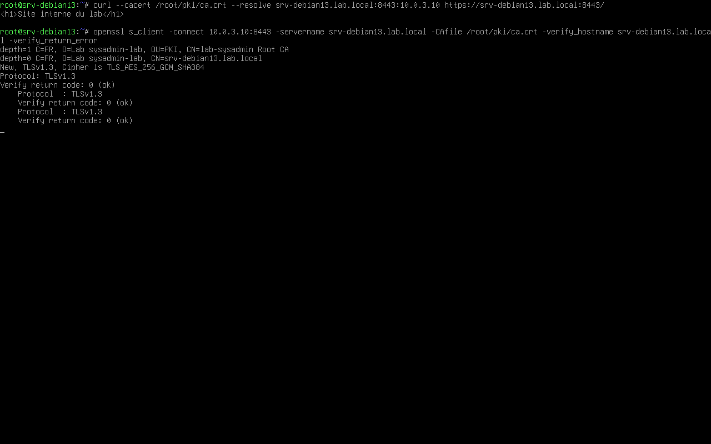
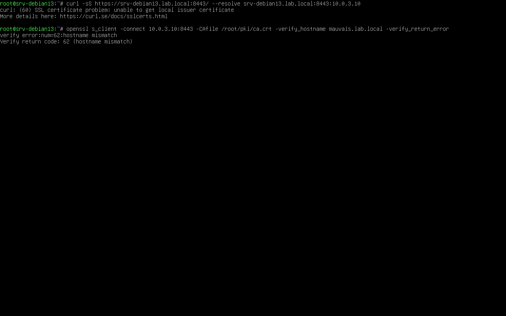
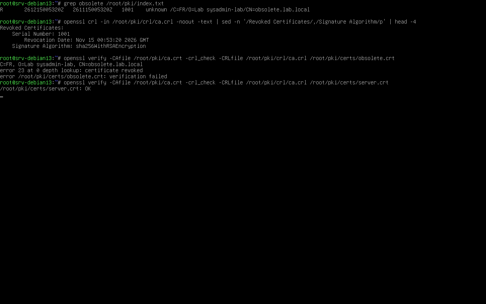

# Créer sa propre autorité de certification avec OpenSSL

## Objectif

Monter une PKI interne complète : une autorité racine auto-signée, l'émission d'un
certificat serveur avec les bons noms et usages, et son utilisation réelle par nginx
en HTTPS. Le but n'est pas de générer un fichier au hasard, mais de prouver la chaîne
entière — signature, vérification du nom, refus sans la CA, puis révocation par CRL.

## Environnement

| Élément | Détail |
|---|---|
| Hyperviseur | QEMU/KVM, machine `srv-debian13` |
| Système | Debian GNU/Linux 13.2 « trixie » |
| Logiciels | OpenSSL 3.5.7, nginx 1.26.3 |
| Racine | `/root/pki`, clé RSA 4096 chiffrée en AES-256 |
| Serveur TLS | `srv-debian13.lab.local` / `www.lab.local` / `10.0.3.10`, port `8443` |
| Validité | racine 10 ans, certificat serveur 397 jours (limite des navigateurs) |

## Architecture

Source : [`schemas/architecture.svg`](schemas/architecture.svg).

## Étapes clés

1. Arborescence de CA classique : `index.txt`, `serial`, `crlnumber`, `newcerts/`,
   `crl/`, et [`configs/openssl.cnf`](configs/openssl.cnf) qui fixe la politique de
   nommage et les extensions.
2. Clé racine RSA 4096 protégée par une phrase de passe (fichier `ca.pass` en mode 600,
   jamais publié) puis certificat auto-signé avec `CA:TRUE, pathlen:0` et
   `keyUsage = keyCertSign, cRLSign`.
3. Clé et CSR du serveur (`CN=srv-debian13.lab.local`), signés par la CA avec les
   extensions `serverAuth` et un SAN contenant les deux noms DNS plus l'adresse IP.
4. Vérification de la chaîne par `openssl verify`, inspection des extensions réelles.
5. Publication : `server.crt` en 644 et `server.key` en 600 dans `/etc/nginx/ssl`, vhost
   TLS [`configs/nginx-tls.conf`](configs/nginx-tls.conf) sur `8443`, `nginx -t` puis
   rechargement.
6. Tests client : `curl --cacert` (HTTP 200, `ssl_verify_result 0`), `openssl s_client`
   avec `-verify_hostname` (TLS 1.3, code 0), puis les deux cas de refus.
7. Révocation : émission d'un second certificat, `openssl ca -revoke`, génération de la
   CRL et vérification `-crl_check` — le révoqué est refusé (code 23), le serveur reste
   valide.

Scripts : [`scripts/creer-pki.sh`](scripts/creer-pki.sh),
[`scripts/tester-tls.sh`](scripts/tester-tls.sh),
[`scripts/revoquer-certificat.sh`](scripts/revoquer-certificat.sh).

## Résultat prouvé

| Capture | Ce qu'elle montre |
|---|---|
|  | L'arborescence réelle de la PKI, la racine auto-signée (`subject = issuer`) valable jusqu'en 2036 et ses contraintes `CA:TRUE, pathlen:0` |
|  | `openssl verify : OK`, l'émetteur racine, les dates, le SAN `DNS:srv-debian13.lab.local, DNS:www.lab.local, IP:10.0.3.10` et l'EKU `serverAuth` |
|  | `curl --cacert` renvoie la page du site (HTTP 200, `ssl_verify_result 0`) et le handshake `s_client` affiche TLS 1.3 avec `Verify return code: 0 (ok)` |
|  | Sans la CA : `unable to get local issuer certificate` ; avec un mauvais nom : `error 62: hostname mismatch` |
|  | Le certificat `obsolete` passe à l'état `R` dans l'index, apparaît dans la CRL (série 1001) et est refusé par `-crl_check` (code 23) alors que `server.crt` reste `OK` |

Journaux :

- [`logs/02-creation-pki.txt`](logs/02-creation-pki.txt) — création complète, code 0.
- [`logs/03-tests-tls.txt`](logs/03-tests-tls.txt) — HTTPS validé, puis les deux refus.
- [`logs/04-revocation.txt`](logs/04-revocation.txt) — révocation et CRL.
- [`logs/05-nom-et-crl.txt`](logs/05-nom-et-crl.txt) — résolution du nom, limites de
  `-crl_check` sans fichier de CRL.

Certificats publics conservés pour inspection :
[`configs/ca.crt`](configs/ca.crt), [`configs/server.crt`](configs/server.crt).
Aucune clé privée, aucun fichier `ca.pass` n'est publié.

## Problèmes rencontrés

| Problème | Cause | Correctif |
|---|---|---|
| Le nom `srv-debian13.lab.local` résolvait vers `127.0.1.1` et non vers `10.0.3.10` | L'entrée de `/etc/hosts` posée lors de l'installation du serveur passe avant le DNS ; `127.0.1.1` est une adresse de boucle locale, pas le réseau du lab | Les tests sérieux visent l'adresse réelle avec `--resolve` (curl) ou `-connect 10.0.3.10` (s_client) ; la résolution par hosts est documentée et ne fausse pas la preuve TLS |
| `openssl verify -crl_check` échouait avec `error 3 … unable to get certificate CRL` | `-crl_check` exige une CRL : sans `-CRLfile`, OpenSSL n'en a aucune à consulter et refuse | Fournir explicitement `-CRLfile /root/pki/crl/ca.crl`, ce que fait le script de révocation |
| La clé racine ne peut pas être utilisée sans phrase de passe | Elle est chiffrée en AES-256 (volontaire) | `-passin file:/root/pki/ca.pass` dans chaque commande `openssl ca` / `req` |

## Durée et publication

- Durée : environ 40 minutes.
- Post LinkedIn : à venir.
