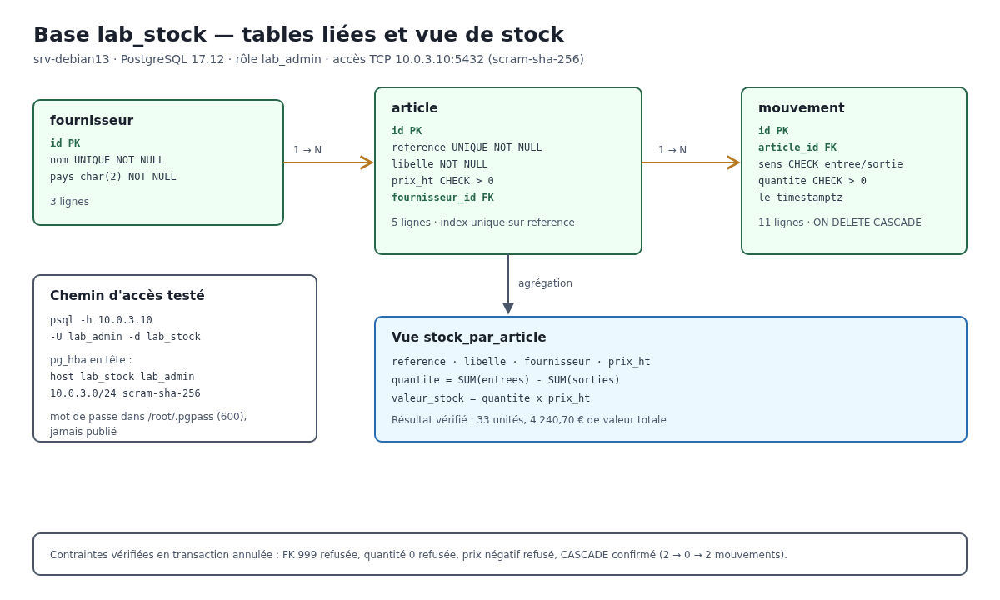
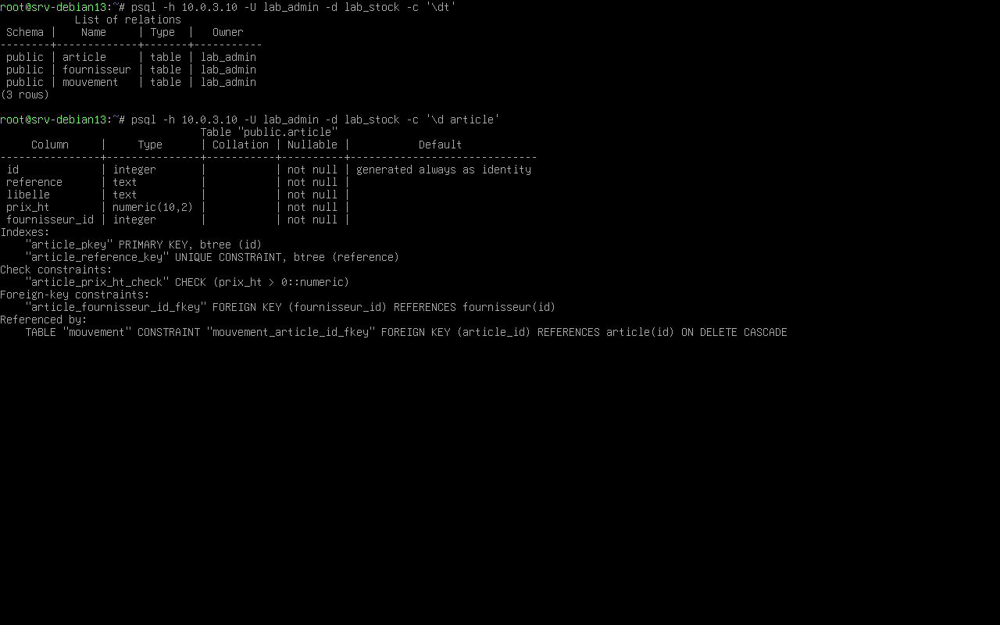
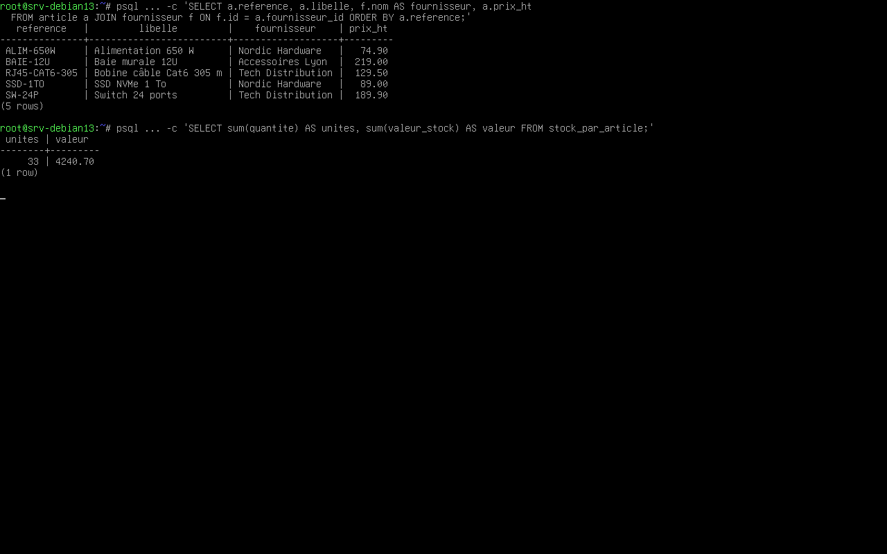
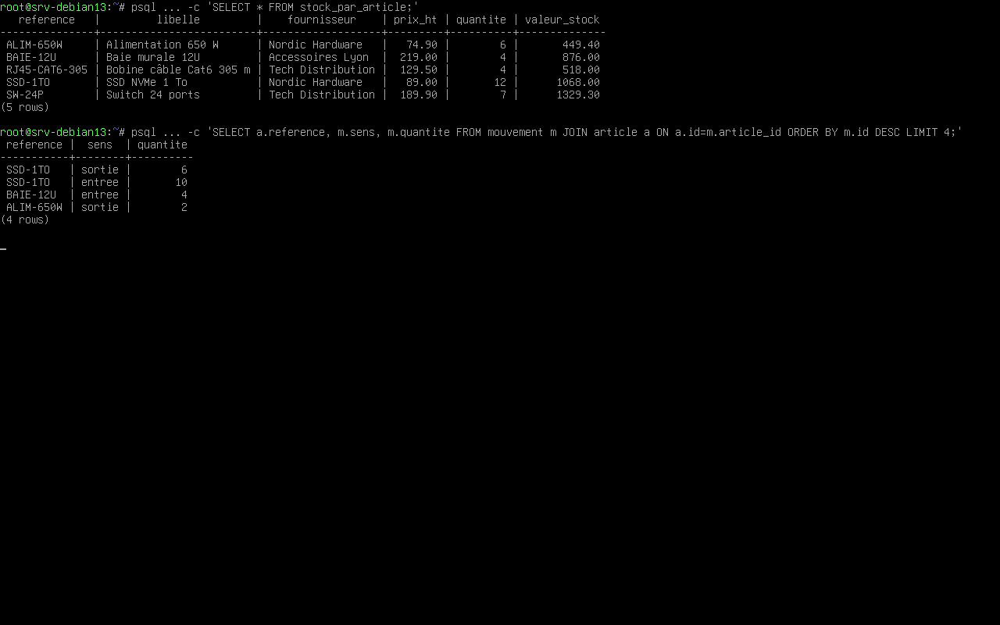
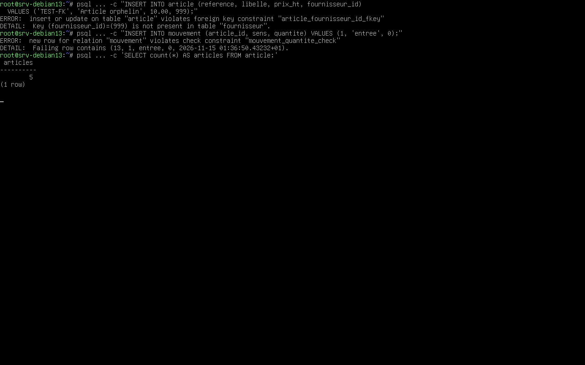
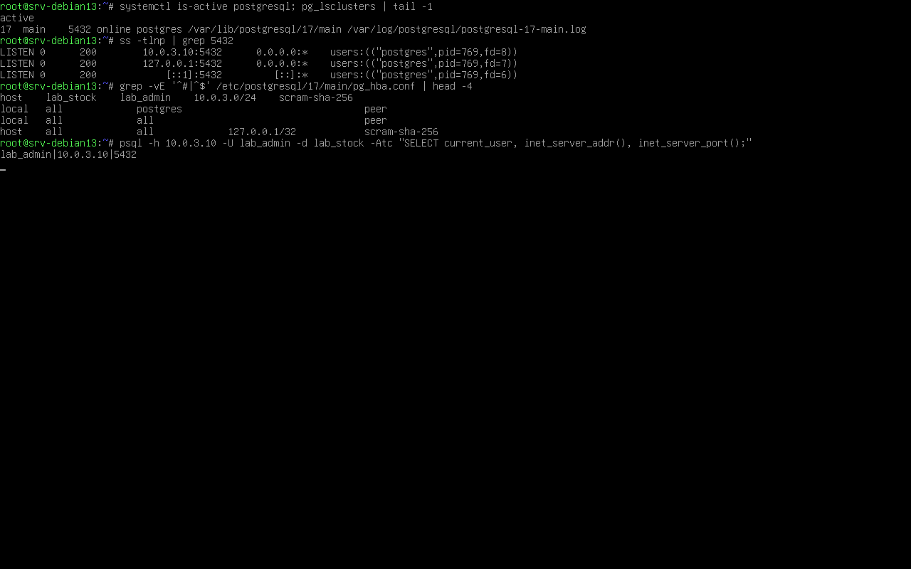

# PostgreSQL : première base avec des tables liées

## Objectif

Installer PostgreSQL sur le serveur du lab et construire une vraie base, pas une table
isolée : un stock de matériel avec des fournisseurs, des articles et des mouvements
reliés par clés étrangères, plus une vue qui calcule le stock restant. La base doit
être accessible par un rôle applicatif dédié, depuis le réseau du lab et pas depuis
n'importe où.

## Environnement

| Élément | Détail |
|---|---|
| Hyperviseur | QEMU/KVM, machine `srv-debian13` |
| Système | Debian GNU/Linux 13.2 « trixie », noyau 6.12.57+deb13-amd64 |
| SGBD | PostgreSQL 17.12 (`postgresql` 17+278), cluster `17/main` |
| Base | `lab_stock`, propriétaire `lab_admin` |
| Adresse d'écoute | `localhost` + `10.0.3.10:5432` |
| Authentification | `scram-sha-256` pour `10.0.3.0/24`, `peer` en local |

## Architecture

Source : [`schemas/architecture.svg`](schemas/architecture.svg).

## Étapes clés

1. Installation de `postgresql` et `postgresql-client`, cluster `17/main` en ligne.
2. Création du rôle `lab_admin` (LOGIN) et de la base `lab_stock` dont il est
   propriétaire ; mot de passe aléatoire écrit uniquement dans `/root/.pgpass` (mode
   600), jamais dans le dépôt.
3. [`configs/schema-lab-stock.sql`](configs/schema-lab-stock.sql) : trois tables
   (`fournisseur`, `article`, `mouvement`) avec `GENERATED ALWAYS AS IDENTITY`, clés
   étrangères, `CHECK` sur le prix, la quantité et le sens, `ON DELETE CASCADE`, index
   `(article_id, le)` et vue `stock_par_article`.
4. [`configs/donnees-lab-stock.sql`](configs/donnees-lab-stock.sql) : 3 fournisseurs,
   5 articles, 11 mouvements — dont deux datés dans le passé.
5. `ALTER SYSTEM SET listen_addresses = 'localhost,10.0.3.10'` puis ajout en **tête**
   de `pg_hba.conf` de la règle `host lab_stock lab_admin 10.0.3.0/24 scram-sha-256`
   (la première règle qui correspond gagne).
6. Redémarrage du cluster, connexion réelle en TCP avec `psql -h 10.0.3.10`, puis
   exécution des requêtes et des tests de contraintes.
   Les deux réglages serveur sont conservés dans
   [`configs/pg_hba-lab.conf`](configs/pg_hba-lab.conf) et
   [`configs/postgresql-auto.conf`](configs/postgresql-auto.conf).
7. Redémarrage de la VM pour vérifier que la base et l'écoute réseau reviennent seules.

Script : [`scripts/creer-base.sh`](scripts/creer-base.sh).

## Résultat prouvé

| Capture | Ce qu'elle montre |
|---|---|
|  | Les trois tables avec `lab_admin` comme propriétaire, et `\d article` qui affiche la clé étrangère, le `CHECK`, l'index unique et la référence entrante depuis `mouvement` |
|  | Jointure `article`/`fournisseur` (5 lignes) puis totaux calculés par la vue : 33 unités, 4 240,70 |
|  | Le stock et la valeur par article, puis les 4 derniers mouvements avec la référence de l'article |
|  | Un fournisseur inexistant (`999`) et une quantité nulle sont refusés par la base ; le compte d'articles reste à 5 |
|  | PostgreSQL à l'écoute sur `10.0.3.10:5432`, la règle `pg_hba` en tête, et une connexion réelle en tant que `lab_admin` sur `10.0.3.10` |

Journaux :

- [`logs/02-installation.txt`](logs/02-installation.txt) — installation, version, cluster.
- [`logs/03-creation-base.txt`](logs/03-creation-base.txt) — création complète, code 0.
- [`logs/04-requetes.txt`](logs/04-requetes.txt) — `\dt`, `\d article`, jointures,
  agrégats, mouvements.
- [`logs/05-contraintes.txt`](logs/05-contraintes.txt) — les quatre tests de contraintes
  avec leurs messages d'erreur, et le retour à l'état initial.
- [`logs/06-persistance.txt`](logs/06-persistance.txt) — après redémarrage de la VM :
  cluster en ligne, écoute sur `10.0.3.10`, données intactes.

## Problèmes rencontrés

| Problème | Cause | Correctif |
|---|---|---|
| Le script s'arrêtait juste après `CREATE DATABASE` avec le code 141 | `set -o pipefail` + `tr -dc … </dev/urandom \| head -c 24` : `head` ferme le tube, `tr` reçoit `SIGPIPE` (128+13 = 141) et le script entier échoue | Génération du mot de passe par `od -An -N12 -tx1 /dev/urandom \| tr -d ' \n'`, sans `head` dans le pipeline |
| `runuser -u postgres -- psql` impossible avec `sudo` | Cette Debian minimale n'installe pas `sudo` | Passage par `runuser`, présent dans `util-linux`, sans dépendance supplémentaire |
| `psql -f /root/schema-lab-stock.sql` n'aurait pas pu lire le fichier | `/root` est en `drwx------` : l'utilisateur `postgres` reçoit `Permission denied` (vérifié) | Le script passe le fichier par l'entrée standard (`< fichier`), la redirection étant faite par root |

## Durée et publication

- Durée : environ 45 minutes.
- Post LinkedIn : à venir.
