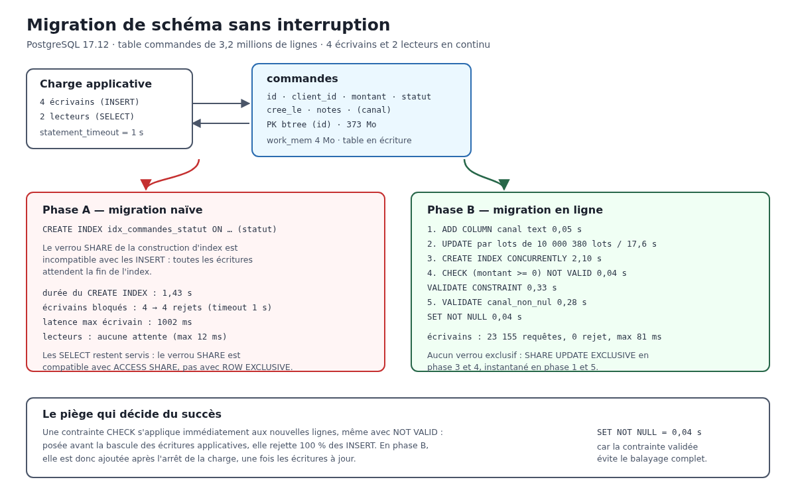
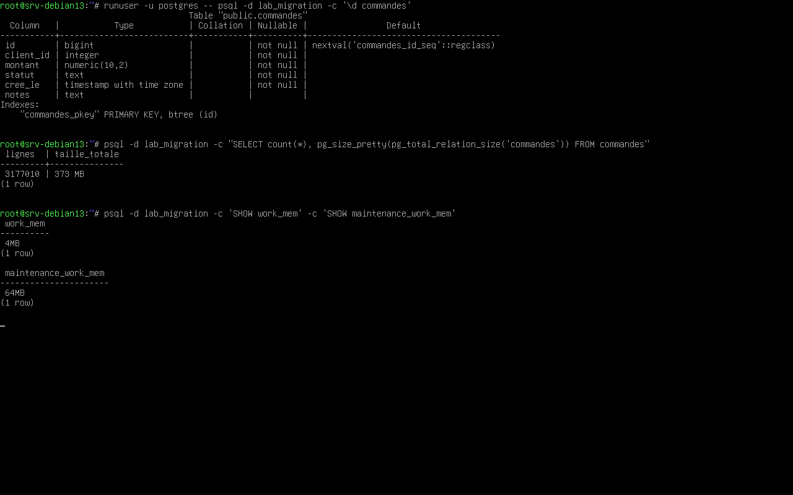
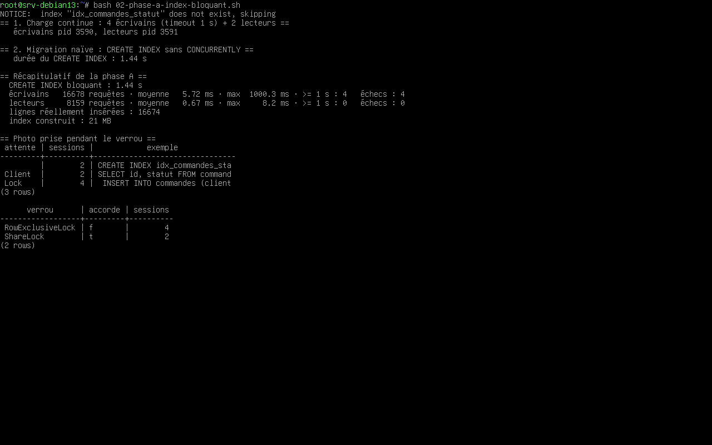
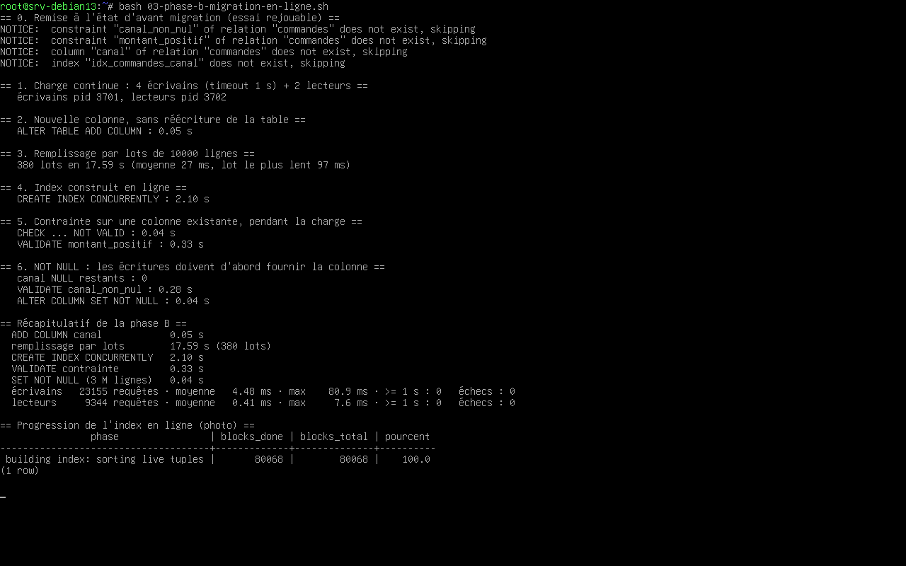
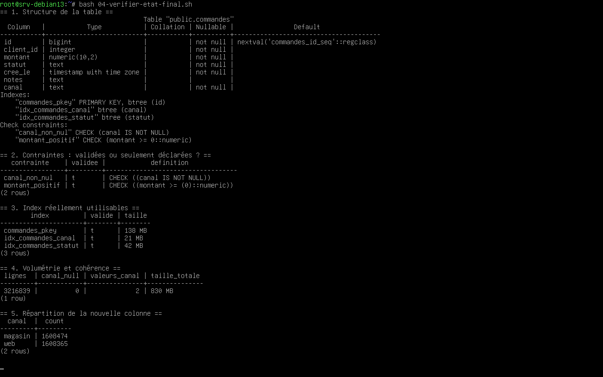

# Mettre en place une procédure de migration de schéma de base de données sans interruption

## Objectif

Modifier une table PostgreSQL de 3,2 millions de lignes (nouvelle colonne, nouvelle
contrainte, nouvel index) sans jamais bloquer les écritures de l'application. Le
projet mesure les deux approches sous charge réelle : une migration naïve qui coupe
les insertions, puis une migration en ligne où les 4 écrivains et les 2 lecteurs ne
perdent aucune requête. Les chiffres viennent de la base, pas d'une estimation.
Projet tiré au hasard dans le catalogue (`16-774`).

## Environnement

| Élément | Détail |
|---|---|
| Hyperviseur | QEMU/KVM, machine `srv-debian13` |
| Système | Debian GNU/Linux 13.2 « trixie » |
| Base | PostgreSQL 17.12 (`/var/lib/postgresql`), base `lab_migration` |
| Table | `commandes` : 3 177 010 lignes, 373 Mo, PK `btree (id)` |
| Réglages | `work_mem` 4 Mo, `maintenance_work_mem` 64 Mo, `max_wal_size` 256 Mo |
| Charge | 4 écrivains + 2 lecteurs, clients Python (`psycopg2`), `statement_timeout` 1 s |
| Mesure | chaque requête horodatée dans un journal (`latence_ms statut`) |

Le `statement_timeout` de 1 s joue le rôle du contrat de service : au-delà, le client
considère la requête comme perdue.

## Architecture

Source : [`schemas/architecture.svg`](schemas/architecture.svg).

## Étapes clés

1. Création de la table et remplissage de 3 000 000 de lignes
   ([`scripts/01-creer-base-et-table.sh`](scripts/01-creer-base-et-table.sh)).
2. Mise en place de la charge continue
   ([`scripts/charge.py`](scripts/charge.py)) : 4 clients qui insèrent, 2 qui lisent
   une ligne au hasard, chaque requête mesurée et journalisée.
3. **Phase A** ([`scripts/02-phase-a-index-bloquant.sh`](scripts/02-phase-a-index-bloquant.sh)) :
   `CREATE INDEX` classique pendant la charge, avec relevé de `pg_stat_activity` et
   `pg_locks` au moment où les sessions attendent.
4. **Phase B** ([`scripts/03-phase-b-migration-en-ligne.sh`](scripts/03-phase-b-migration-en-ligne.sh)) :
   `ADD COLUMN`, remplissage par lots de 10 000 avec un `COMMIT` par lot,
   `CREATE INDEX CONCURRENTLY`, contrainte `NOT VALID` puis `VALIDATE`, et enfin
   `SET NOT NULL`.
5. Vérification de l'état final
   ([`scripts/04-verifier-etat-final.sh`](scripts/04-verifier-etat-final.sh)) :
   contraintes réellement validées, index valides, aucune ligne `NULL`, répartition
   de la nouvelle colonne.

## Résultat prouvé

| Capture | Ce qu'elle montre |
|---|---|
|  | La table de départ : 6 colonnes, une seule PK, 3 177 010 lignes, `work_mem` à 4 Mo |
|  | `CREATE INDEX` en 1,44 s, 4 écrivains bloqués avec `RowExclusiveLock` non accordé, latence max 1000 ms, 4 inserts rejetés par le timeout ; recapitulatif mesuré |
|  | Les cinq étapes avec leur durée, `CREATE INDEX CONCURRENTLY` en 2,10 s (index à 100 %), 23 155 requêtes d'écriture, **0 rejet**, latence max 81 ms |
|  | Les deux contraintes `validee = t`, trois index `valide = t` (`canal` 21 Mo), 3 216 839 lignes, 0 `NULL`, et la répartition web/magasin |

| Mesure | Phase A (naïve) | Phase B (en ligne) |
|---|---|---|
| Construction de l'index | 1,43 s, verrou SHARE | 2,10 s, sans verrou exclusif |
| Requêtes d'écriture | environ 17 000 | 23 155 |
| Écritures rejetées (timeout 1 s) | **4** | **0** |
| Latence maximale (écrivains) | 1002 ms | 81 ms |
| Latence maximale (lecteurs) | 12 ms | 8 ms |
| Colonne et contraintes | — | 5 étapes, 0,04 à 0,33 s chacune |

La migration en ligne est donc **plus lente** sur l'index (2,10 s contre 1,43 s) mais
elle ne coûte aucune requête : c'est le compromis attendu.

Journaux complets :

- [`logs/01-etat-initial.txt`](logs/01-etat-initial.txt) — PostgreSQL 17.12, base
  `lab_stock` existante, espace disque, mémoire.
- [`logs/02-creation-table.txt`](logs/02-creation-table.txt) — insertion des
  3 000 000 de lignes en 9,5 s, taille et réglages.
- [`logs/03-phase-a-index-bloquant.txt`](logs/03-phase-a-index-bloquant.txt) —
  phase naïve : durée, bilan de charge, photo des verrous.
- [`logs/04-phase-b-migration-en-ligne.txt`](logs/04-phase-b-migration-en-ligne.txt) —
  phase en ligne, étape par étape, avec la progression
  `pg_stat_progress_create_index`.
- [`logs/05-etat-final.txt`](logs/05-etat-final.txt) — état final complet.

Les captures proviennent d'un second passage : les valeurs varient de quelques
pourcents d'une exécution à l'autre, ce qui est la réalité d'une mesure de charge.
Les journaux donnent le premier passage.

## Problèmes rencontrés

| Problème | Cause | Correctif |
|---|---|---|
| `pgbench: relation "commandes" does not exist` | `pgbench` prend le nom de base en argument positionnel ; lancé sans nom, il visait la base `postgres` | Passer la base en dernier argument — puis abandon de `pgbench` : au premier timeout, il abandonne le client, ce qui fausse la mesure d'une migration de plusieurs secondes |
| Tous les inserts comptés en erreur alors qu'ils réussissaient | `cur.fetchall()` sur un `INSERT` lève `no results to fetch` | Ne récupérer un résultat que pour le `SELECT` |
| Script de remplissage interrompu après le dernier lot | `read` sur une substitution de processus sans saut de ligne renvoie 1, et `set -e` arrête le script | Terminer le `printf` d'`awk` par `\n` |
| **100 % des écritures rejetées après l'ajout de la contrainte** | `CHECK (canal IS NOT NULL) NOT VALID` ne valide pas les lignes existantes, mais s'applique **immédiatement** aux nouvelles : les écrivains n'écrivaient pas encore `canal` | Poser la contrainte après la bascule des écritures applicatives ; dans le run final, elle est ajoutée après l'arrêt de la charge, et `SET NOT NULL` reste instantané grâce à la contrainte validée |
| `could not extend file ... No space left on device` pendant `CREATE INDEX CONCURRENTLY` | `/var` ne faisait que 2,8 Go ; deux remplissages complets avaient produit ~1 Go de WAL et doublé la taille de la table (1 070 Mo) | Réduit `/home` (inutilisé, 1,9 Go) et étendu `/var` à 4,5 Go par LVM, puis `VACUUM FULL` et `max_wal_size` ramené à 256 Mo |
| `SET NOT NULL` instantané alors que la table fait 3,2 millions de lignes | PostgreSQL 12+ réutilise une contrainte `CHECK` validée au lieu de rebalayer la table | C'est le comportement voulu : 0,04 s au lieu d'un balayage complet sous verrou exclusif |

## Durée et publication

- Durée : environ 2 heures (dont une bonne partie à comprendre les limites de
  `pgbench` et à agrandir le volume `/var`).
- Post LinkedIn : à venir.
- Auteur : [Jenovi Dandou](https://www.linkedin.com/in/jenovi-dandou).
